# Notion 表格交互对照与 MemoCard 验收

2026 年 10 月 28 日。MemoCard 已将文档底部整排表格按钮改为跟随当前单元格的「行 / 列 / 表格」入口，并修复非标准表头的保存回读。此次针对笔记正文的简单表格，不扩展为数据库。

后续外围留白、单块 / 多块 / 单元格选区，以及空白点击、编辑和拖动的完整复验见：[表格选区回归记录](selection-audit/README.md)。该记录包含最新测试数量与修复结果。

参考页面：[Portfolio — Notion CMS 数据库设计指南](https://app.notion.com/p/Portfolio-Notion-CMS-30f0eb3ea8b4816d8055f76892680191)。浏览器检查只操作焦点、选区和菜单，没有修改该页面内容。

## Notion 的点击与操作层级

| 操作阶段 | 当前页面的直接观察 | 对 MemoCard 的意义 |
| --- | --- | --- |
| 单击单元格 | 光标直接进入原单元格，蓝色边框指明当前目标；没有额外编辑弹窗 | 保留直接编辑，补清晰的当前单元格提示 |
| 切换单元格 | Tab 横向切换；编辑位置仍留在表格中 | 保留编辑引擎已有的 Tab / Shift+Tab 行为 |
| 点击列把手 | 选中整列，菜单包含标题列、颜色、左侧插入、右侧插入、创建副本、清除内容、删除 | 用独立列菜单表达作用范围和插入方向 |
| 点击行把手 | 选中整行，菜单包含颜色、上面插入、下面插入、创建副本、清除内容、删除 | 用独立行菜单，减少误把「添加行」理解为追加到表尾 |
| 菜单呈现 | 菜单靠近入口，危险操作在底部；入口随当前表格出现 | 将操作从文档底部移到当前编辑位置，删除项独立分组 |

Notion 的核心是「编辑单元格、操作行列、设置整张表格」三个不同作用域。MemoCard 原先将这些操作放进同一排按钮，用户需要自行判断每个按钮作用于何处。

Notion 官方还说明了边缘加行列、拖动列宽、标题行列、矩形选区合并与拆分、适配页面宽度等能力。这些属于官方文档补充，未在参考笔记中执行结构修改：[Format your page](https://www.notion.com/help/columns-headings-and-dividers)、[Simple tables guide](https://www.notion.com/nb/help/guides/simple-tables-vs-databases)。

## 原实现的问题与本次处理

| 问题 | 原行为 | 最终行为 |
| --- | --- | --- |
| 操作离内容太远 | 工具排位于整篇编辑器末尾，使用 sticky 固定在底部；参考笔记有多张表格 | 操作条跟随当前单元格，在视口边界内定位；横向滚动时跟随可见单元格 |
| 方向与作用域不明确 | 添加行、添加列没有说明插入位置 | 行菜单提供上方 / 下方；列菜单提供左侧 / 右侧；入口的无障碍名称包含行列编号 |
| 基础与高级能力混排 | 表头、合并拆分、表尾、删除并列 | 表格菜单集中标题行列、合并 / 拆分、表尾和表头范围；不可用项禁用 |
| 菜单焦点可能干扰选区 | 直接 focus 后执行命令 | 打开时保存原选区；命令恢复该选区；外部正文更新使旧菜单失效；退出后恢复编辑焦点 |
| 结构操作与输入撤销混杂 | 直接调用命令 | 使用现有结构事务边界，一次菜单操作单独撤销 |
| 非标准表头保存丢失 | 默认 GFM 序列化给无表头表格补空头，标题列也不能完整表达 | 标准首行表头继续 GFM；无表头、混合表头、标题列改用现有 HTML 表格回退保存 |
| 选中文字时入口竞争 | 就近工具可能与文字格式条重叠 | 文字选区优先显示文字格式条，单元格范围选区仍可打开表格菜单合并 |

桌面与触屏共同使用有文字的三个菜单入口，没有照搬 Notion 的微型悬停把手。375px 场景中按钮与菜单项至少 44px 高；Shift+F10 可直接从单元格打开表格菜单。此次不增加行列拖动、列宽拖动、颜色、创建副本、清空内容或数据库转换。

焦点提示位于编辑器正文之外，避免对单元格 DOM 的样式修改被编辑引擎误判为笔记编辑；控制层不会进入保存内容。

## 截图与逐步验收

1. **Notion 单元格编辑：可用。** 点击 Slug 后出现原位光标与当前格边框。小把手主要依赖鼠标发现，截图不能证明完整屏幕阅读器支持。

   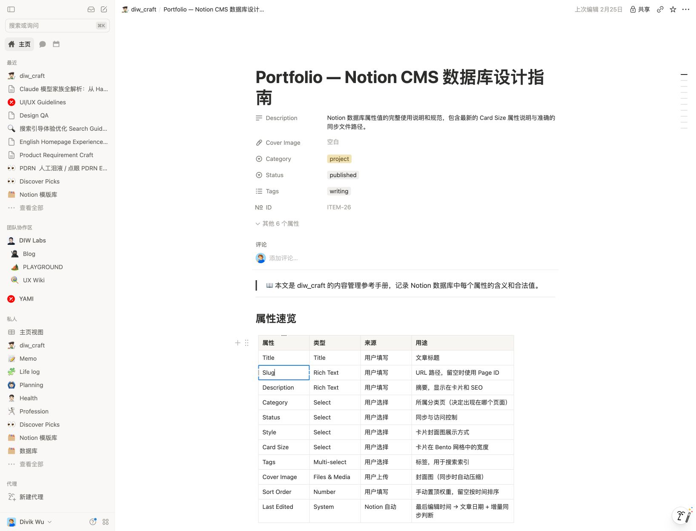

2. **Notion 列菜单：层级清楚。** 整列边框明确范围，标题列与左右插入分开呈现；这里只观察菜单，没有执行命令。

   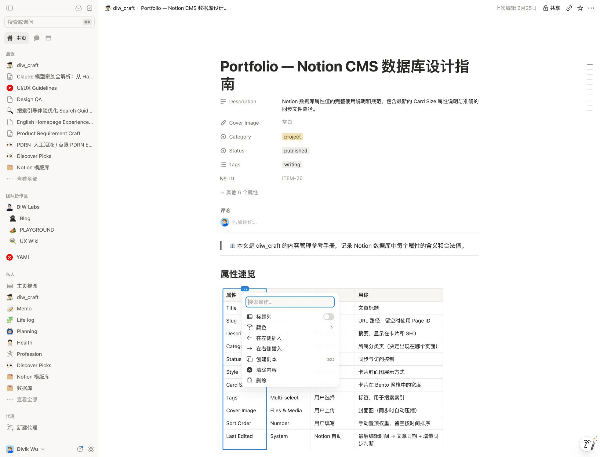

3. **Notion 行菜单：方向明确。** 上方、下方插入和删除分组；整行边框帮助识别目标。

   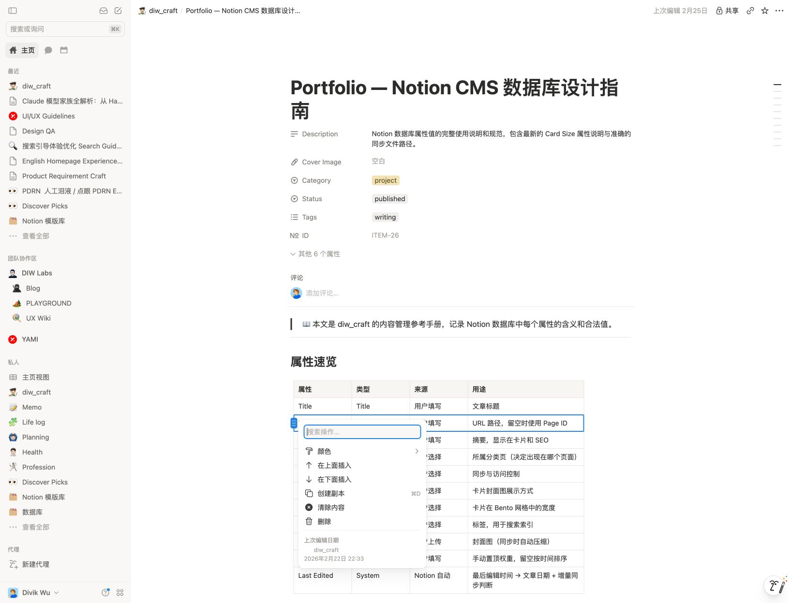

4. **MemoCard 原界面：操作距离较远。** 当前表格在页面中部，命令排在视口底部，编辑目标和操作区分离。

   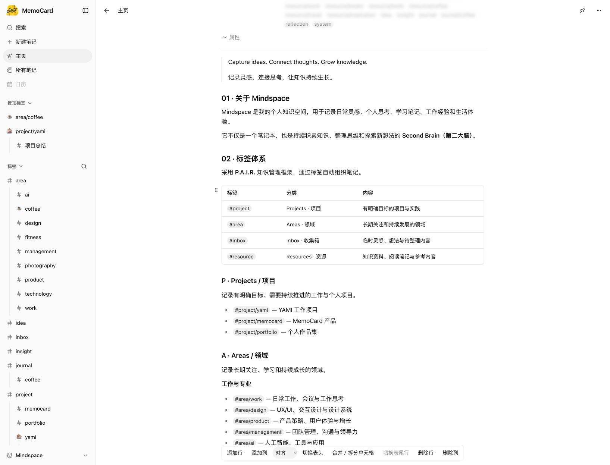

5. **MemoCard 当前单元格：通过。** 原位编辑不增加步骤，独立提示层指明当前格，三个入口在单元格附近。选择文字时交给原有文字格式条。

   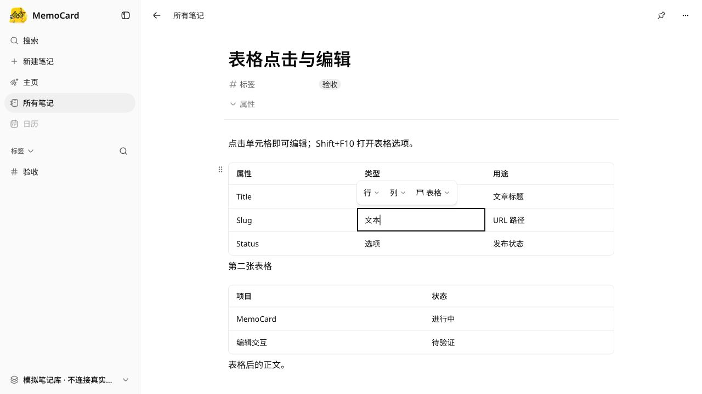

6. **MemoCard 行菜单：通过。** 浏览器实际执行上方插行，第一张表由 4 行变为 5 行，第二张表保持 3 行；一次撤销后恢复。命令后焦点回到编辑器。

   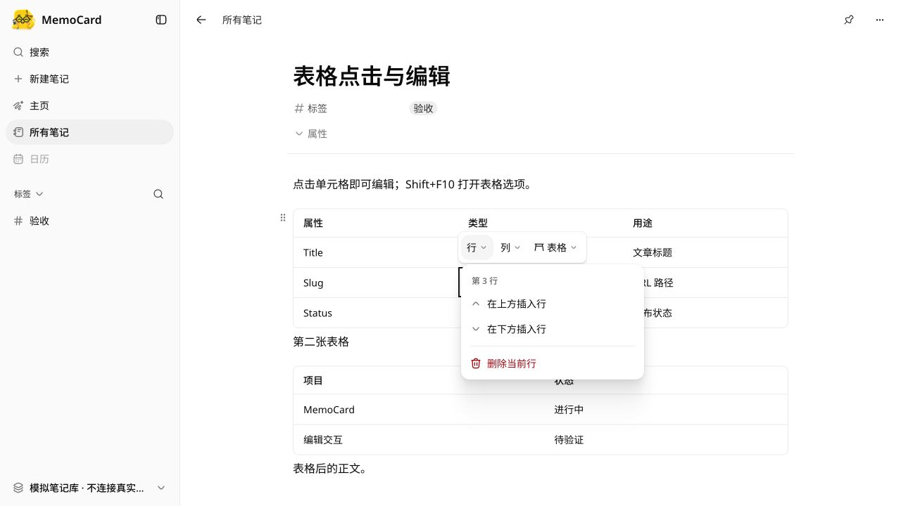

7. **MemoCard 列菜单：通过。** 浏览器选择居中后，当前列四个单元格均为居中；一次撤销恢复。左右插列和删除作用域另由真实编辑器测试覆盖。

   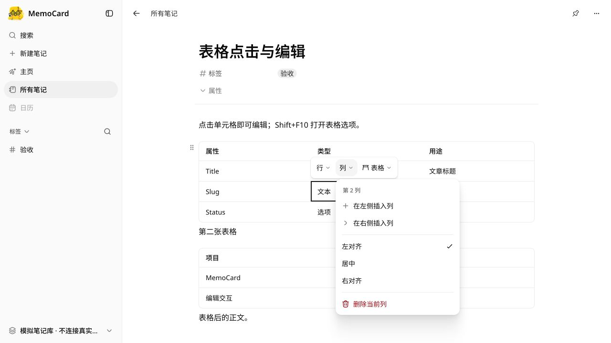

8. **MemoCard 表格设置：通过。** Shift+F10 可打开菜单；当前标题行状态可见，普通光标下合并、拆分禁用；Esc 返回原光标。矩形单元格选区的合并拆分由真实编辑器测试覆盖。

   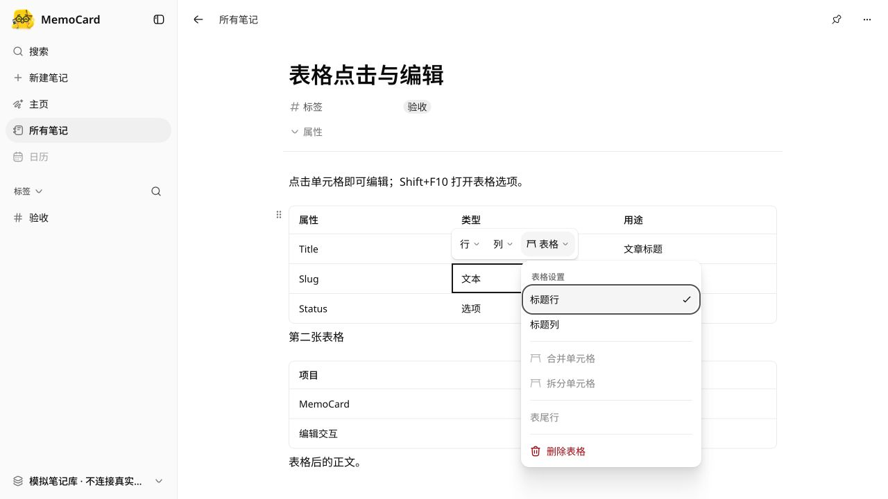

9. **375px 操作条：通过。** 当前格与入口均可见，三个入口在窄屏内容范围内。

   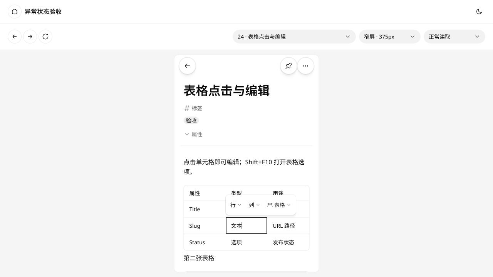

10. **375px 菜单：通过。** 可用空间不足时列菜单向上避让，菜单完整显示，操作目标仍保留。此为浏览器窄屏场景，不代表实体手机软键盘验收。

    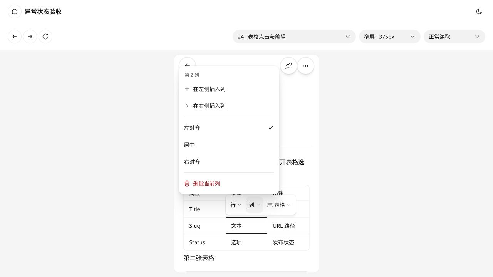

11. **375px 横向滚动：通过。** 新增一列后表格为 394px、容器为 327px；向右滚动 67px 后，操作条仍在 375px 内容范围内，当前单元格提示随之移动。

    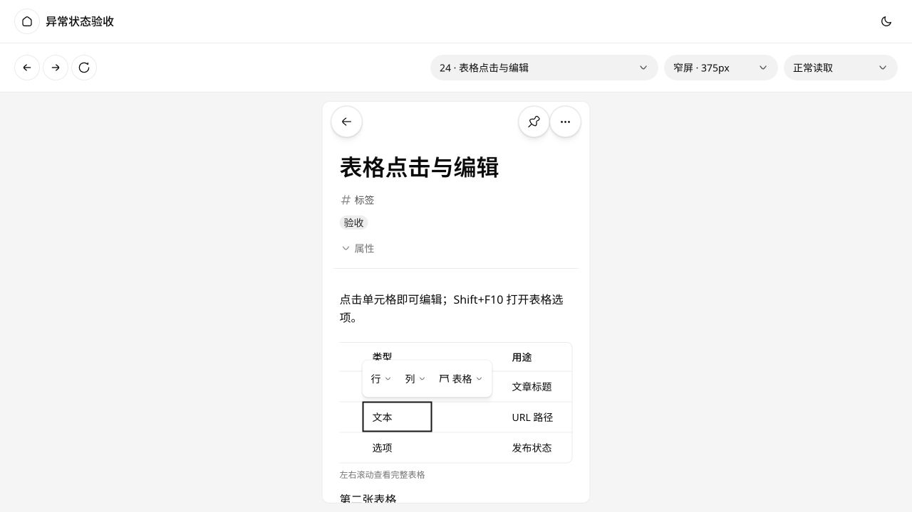

## 验证与交付范围

- 新表格交互与持久化回归覆盖正确目标、方向插入、单步撤销、矩形选区合并拆分、Esc、外部点击、Shift+F10、Tab、禁用、外部更新和表头回读。
- 最终共享测试 1,096 项、UI 测试 448 项，共 1,544 项通过；其中新增表格交互 16 项、持久化 5 项。类型检查、lint、生产构建、包体预算与组件 / token 清单检查通过。浏览器首屏列表为 332,201 gzip bytes，保持原预算。
- 浏览器使用隔离预览中的模拟笔记；真实笔记库、Notion 原文与运行中的本机服务未替换。
- 实体 iPhone / iPad、完整软键盘、外接键盘和屏幕阅读器矩阵另需设备验收；不能据截图声称完整无障碍合规。
- 预览入口：`http://127.0.0.1:5182/client.html?scenario=tables`；窄屏入口：`http://127.0.0.1:5182/?scenario=tables&viewport=mobile`。运行 `pnpm --filter @memocard/ui dev:states` 可重开场景。
