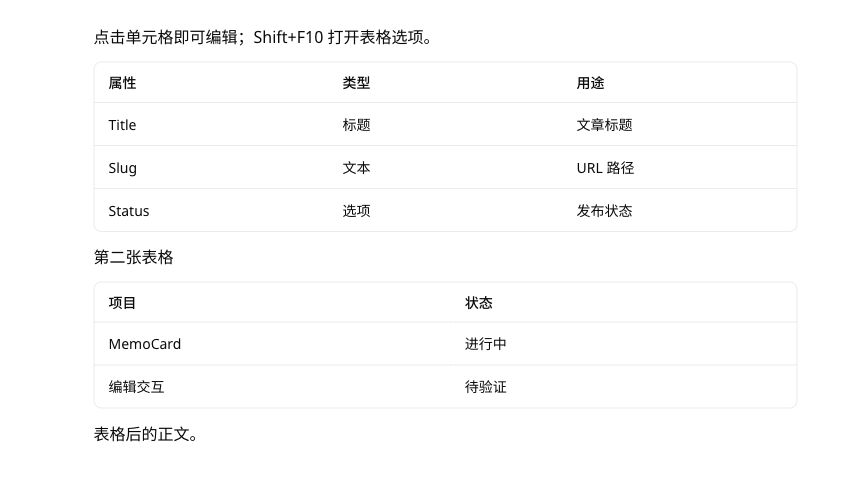

# 表格选区、留白与拖动回归

2026-10-28，针对表格外围留白、选中背景及点击空白仍停留在表格的问题复验。浏览器使用 `5182` 的模拟笔记场景。

| 路径 | 验证结果 |
| --- | --- |
| 单块选中 | 点击表格把手产生整表 NodeSelection；从单元格范围或非空文字选区切换也能正确选中整块 |
| 多块选中 | 表格与相邻段落可扩展、收缩及整组选中；表格和段落使用相同的外围 padding 与选中背景 |
| 单元格选择 | 单格与 2×2 矩形范围只给目标单元格上色；外层不误显示整块背景 |
| 留白与尺寸 | 表格与段落上下 padding 均为 6px；整块背景 inset 均为 `2px -6px`；切换选区不改变单元格 padding、宽高、滚动宽度或溢出提示 |
| 页面留白点击 | 左侧、右侧、上方留白均清空选区并失焦；无黑色当前格边框、蓝色背景或表格操作条；打开块菜单时点留白也可退出 |
| 点击与框选 | 左侧留白单击允许 4px 指针抖动；真正拖入表格与段落仍形成块范围；Escape 取消恢复原选区 |
| 拖到正文下方 | 完成框选后的 click 不会误触“继续写入”；下一次普通下方点击仍可新增段落 |
| 编辑与撤销 | 重新点击单元格可输入；一次撤销恢复原文，其他单元格及第二张表格不受影响 |
| 拖动与撤销 | 真实鼠标将单表格、表格加相邻段落移动到文末；一次撤销恢复完整内容与顺序；取消拖动不写正文 |
| 列对齐 | 正反方向矩形选择均以入口显示的锚点列作为操作目标；其他列保持原值，可一次撤销及保存回读 |

本轮修复了已有单元格选区转整表时未切换选区、矩形选择的列对齐读取终点列、页面空白未清除表格状态，以及框选结束误追加段落四类问题。

## 验证

- 共享测试 1,125 项、UI 测试 448 项通过，共 1,573 项；其中表格选区、拖放、编辑与空白退出回归为 26 项。
- 桌面与窄屏 Story 浏览器回归共 11 项；检查选区几何、真实输入、留白点击、矩形拖动及下方继续写入。
- 类型检查、UI / Storybook 类型检查、lint、生产构建、包体预算、设计清单与 diff 检查通过。浏览器首屏列表为 332,203 gzip bytes，预算保持不变。
- 另使用应用内浏览器的真实鼠标点击、矩形拖动、把手拖放、输入及撤销复验。模拟笔记最终恢复原内容，未写入真实笔记库。
- 窄屏覆盖为浏览器场景；未新增实体 iPhone / iPad、完整软键盘或外接键盘验收。

## 浏览器证据

1. [单表格拖动](01-single-table-drag.png)
2. [表格与段落多块选择](02-local-multi-block-selection.png)
3. [多块整体拖动](03-multi-block-drag.png)
4. [矩形单元格选择](04-rectangle-cell-selection.png)
5. [单元格范围切换整表选择](05-cell-to-block-selection.png)
6. 点击页面留白后的最终状态：无选中背景、当前格边框或操作条。

   
