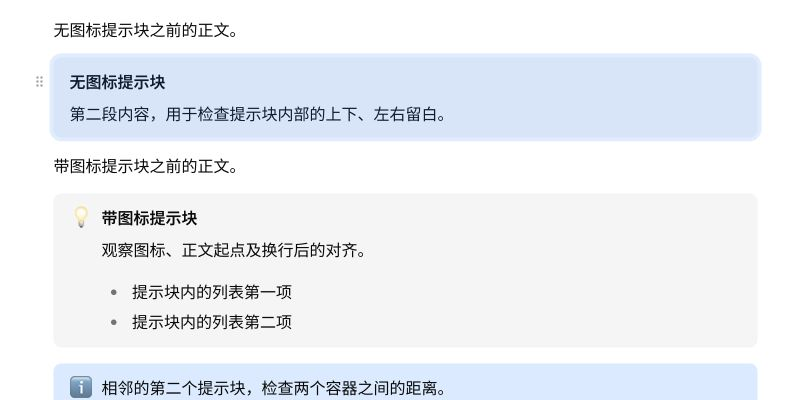
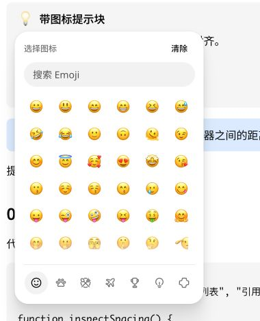
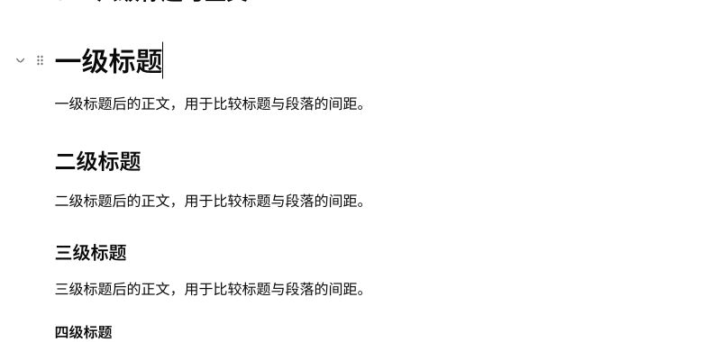
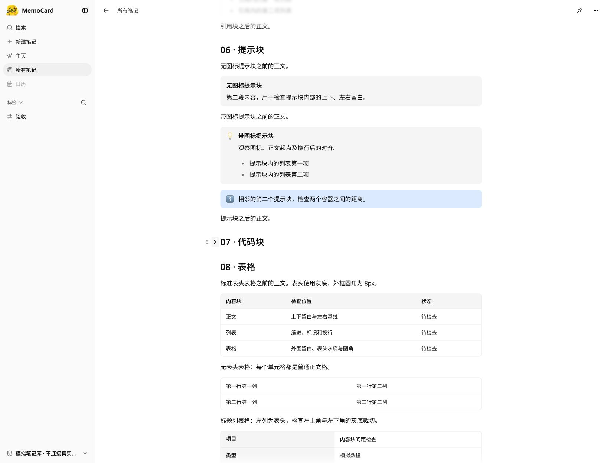
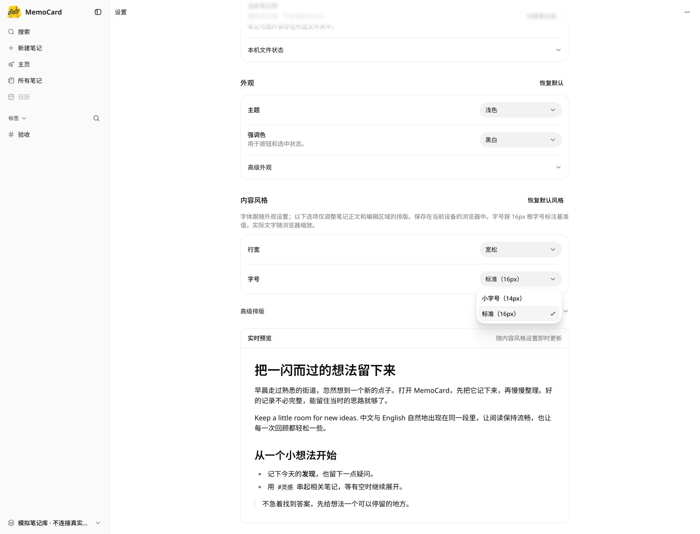
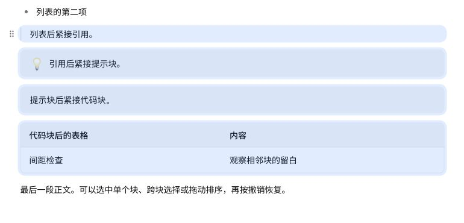
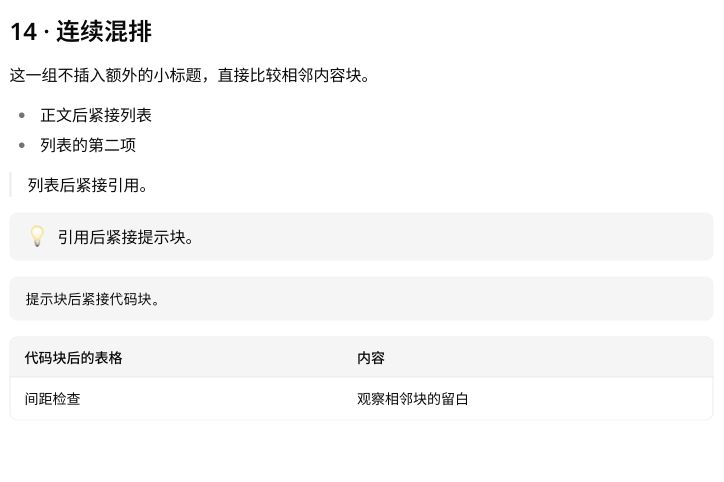
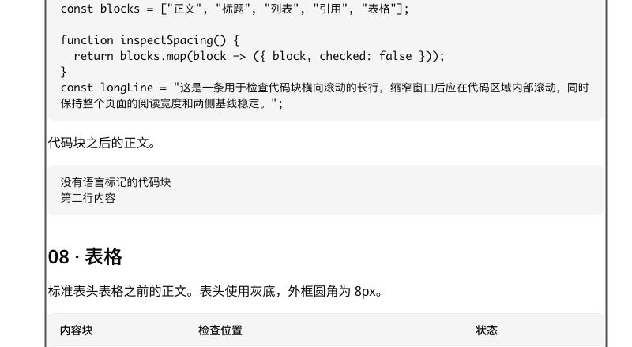

# Notion 参考排版实现与验收

2026-10-28。实现此前确认的整体方案，预览环境为本地模拟页面。

## 已实现

- 字号仅保留标准 16px、小字号 14px；当前默认行高分别为 24px / 22px。15px、18px 旧值迁移为 16px；保存的行高键继续映射到对应档位，段距保留。
- 行宽按 16px 参考字号计算，切换小字号不收窄内容列。标题采用明确的偶数档位：H1 30 / 26px，H2 24 / 22px，H3 20 / 18px；H4–H6 使用正文大小并保留字重和颜色层级。
- 行高、段落间距移入默认收起的“高级排版”，移除随机搭配，保留恢复默认风格。旧 em 段距按所选正文字号转换为 rem，避免标题字号放大同一间距值，同时跟随浏览器根字号变化。
- 编辑和阅读共用顶层块间距：正文与普通容器 16px，列表项 6px；H1 / H2 / H3 前为 40 / 36 / 32px，H4–H6 前为 24px，标题后为 16px。首块不增加外部 margin。
- 通过扣除编辑命中区域已有留白，得到最终可见间距；保留代码、提示块、单元格等内部 padding 和各视图的独立字号规则。公式阅读输出显式作为块排版，消除行内包装对外部间距的干扰。
- 保留容器 8px 圆角、独立引用竖线、四周 4px 选中外扩、容器选中 12px 圆角及单元格格内选择。

## 首轮验证（偶数档位调整前）

- 共享测试 1,131 项、UI 测试 448 项通过。
- 桌面 13 项、窄屏 8 项浏览器回归通过。新增两档字号的编辑 / 阅读间距矩阵，14px 全格式选中几何及编辑撤销回归。
- 字号切换、旧值迁移、保存 / 重开、跨标签同步、存储写入失败、字体加载恢复和编辑历史保留均有回归覆盖。
- 应用内浏览器实测 16px / 24px、14px / 21px；设置预览宽度两档均为 702px，笔记正文列均为 704px。
- 实际在 14px 笔记中选择引用、提示块、代码、表格四块并拖动，一次撤销恢复全部 87 个块的内容与顺序；代码、单元格输入后撤销恢复，点页边空白清除选中层和表格操作条。已恢复标准 16px。
- 类型检查、UI / Storybook 类型检查、lint、生产构建、包体预算、设计清单及 diff 检查通过。未新增实体设备验收。

## Review 修复复核

- 搜索预览排除正文的新排版规则，保留紧凑的字号、行高、段距和标题比例；14 / 16px、行高 1.5 / 1.9、默认 / 自定义段距均不会改变搜索预览。
- 折叠章节后的标题以前一个可见标题计算间距，避免隐藏的代码、引用或列表干扰。两档字号与嵌套标题均有回归；模拟页面实测“07 · 代码块”折叠后至“08 · 表格”为 36px，随后恢复展开，87 个内容块保留。
- 自定义 1em / 1.25em / 2em 段距在 16 / 20px 根字号下按正文比例缩放；编辑与阅读一致，原有内部 padding 继续按既有 token 缩放。
- 本次新增 Chromium / WebKit 浏览器回归 16 项通过，既有桌面 / 窄屏编辑器回归 21 项通过（含选中几何、编辑撤销和拖动），排版 / 搜索 / 字体恢复单元测试 13 项通过。类型检查、lint、生产构建及设计清单检查通过。

## 列表间距补偿修复

- 允许外部 margin 为负值，完整扣除编辑命中区的既有 padding。14px + 1em 时，相邻无序、有序和任务列表的可见间距均为 14px，与阅读态一致。
- 列表补偿改用现有 spacing token，列表项的外部 margin 由 6px 目标间距减去两侧实际 padding 得到。根字号 20px 时，列表项内部 padding 仍为 2.5px，列表外层 padding 仍为 7.5px；项间可见间距保持 6px。
- 新增长期回归覆盖两档字号、16 / 20px 根字号、390 / 1024px 视口，以及默认 16px 和全部 em 段距；逐对检查正文、三类列表、引用、提示、代码、表格与分隔线。列表单块 / 多块原生拖放后，内容顺序正确，一次撤销恢复。
- 本轮 Chromium / WebKit 排版与拖动回归 96 项、桌面 / 窄屏编辑器回归 21 项、相关单测 13 项通过；类型检查、lint、生产构建通过。内部 padding 与选中背景的 4px 外扩规则未改动。

## 无图标提示块操作入口修复

- 原因：无图标提示块的“＋添加图标”按钮与外置块手柄同时占用了左侧操作区。无图标时现在只显示块手柄；添加图标使用现有“块菜单 → 编辑图标”，已有图标仍可直接点击修改。
- 菜单入口使用持续挂载的块手柄定位图标浮层，并保留节点视图的实时位置引用；菜单关闭时不会抢走图标搜索框的焦点，Escape 返回对应入口。无图标提示块的内部 padding 保持 12px 16px。
- 新增 14 / 16px、390 / 1024px 下的入口、浮层定位与焦点、添加 / 修改 / 撤销图标、块拖放及撤销回归。Chromium / WebKit 与既有编辑器浏览器回归合计 125 项通过；共享 1,131 项、UI 448 项单测通过，lint 与生产构建通过。
- 首次并行单测出现一次侧栏设置页加载等待超时；该文件单独运行 35 项及随后完整共享测试均通过，未修改该测试。模拟页实测菜单正常定位并聚焦“搜索 Emoji”，关闭后保留 87 个内容块。

## 表情浮层外观修复

- 独立表情浮层复用了侧栏内嵌选择器，原先额外带入 1px 顶部分隔线和 12px 顶部 padding。仅在提示块独立浮层内移除这两项，保留外框 12px padding 及底部分类分隔线；侧栏内嵌版本保留原样。
- 移除浮层局部 16px 圆角覆盖，继承共享 Popover 的圆角（默认 20px），同时跟随外观设置变化；移动端继续使用共享 sheet。
- Chromium / WebKit 的 106 项浏览器回归通过，覆盖两档字号、桌面 / 窄屏、独立 / 内嵌分隔线、圆角随 token 更新、图标编辑、拖放及撤销。相关 UI 单测 9 项、生产构建通过。
- 模拟页实测：外部 padding 为 12px，内部顶部 border / padding 均为 0，外框圆角为 20px。

## 偶数字号与行高

以下为 16px 根字号下的字号 / 行高基准（px），系统字体放大与浏览器缩放继续按比例生效。

| 内容 | 标准档 | 小字号档 |
| --- | --- | --- |
| 正文 / H4–H6 | 16 / 24 | 14 / 22 |
| H1 | 30 / 40 | 26 / 34 |
| H2 | 24 / 32 | 22 / 28 |
| H3 | 20 / 26 | 18 / 24 |
| 编辑器表格 | 14 / 22 | 14 / 22 |
| 代码 / 图注 / 脚注 | 14 / 20 | 14 / 20 |

- 标准档高级行高为 24 / 26 / 28 / 30px，小字号档为 22 / 24 / 26 / 28px；设置显示实际 px 档位，保留既有存储键与跨标签同步机制。
- 阅读表格保留 16 / 24px 的独立字号规则。提示块图标按新的正文行高居中；内部 padding、块间距、列表项间距和四周 4px 选中外扩保持原规则。
- Chromium / WebKit 与桌面 / 窄屏回归 135 项通过，完整共享 1,131 项与 UI 449 项单测通过；类型检查、lint 和生产构建通过。
- 模拟页实测标准与小字号档全部主文字指标符合上表；保留 87 个块，完成后恢复标准 16px。

## 内容块左侧按钮间距

- 所有块的拖动手柄距可见边缘统一为 6px；选中背景外扩 4px 后，与按钮之间留 2px。标题按“折叠、拖动”排列，两个按钮之间为 2px，图标统一使用次要文字颜色。
- 嵌套列表按当前列表层级的边缘定位，图片按实际图片容器定位；窄屏按实际按钮宽度补偿。内容块内部 padding、选中背景外扩和圆角保持原规则。
- 新增 Chromium / WebKit 的 8 项几何回归，覆盖 14 / 16px、390 / 1024px 和各类内容块；模拟页实测标题、段落、嵌套列表均为 6px，标题按钮间距及选中背景至按钮间距均为 2px。
- 按钮左移后暴露菜单贴近视口左边缘时的横向翻转循环；块菜单和插入菜单改为横向平移避让，保留上下翻转和 12px 视口留白。最终组合运行的 143 项浏览器回归全部通过，包含编辑、折叠、块 / 单元格选中、拖动及撤销。
- 清理测试依赖缓存后的首次组合运行出现图标浮层的重复 React hook 错误；依赖优化完成后重新完整运行通过，未改动产品依赖。

## 发布前 review

- 修复触摸页面空白处未清除表格选区的问题；覆盖光标、格内文字、矩形单元格和整块表格四种状态，不捕获触摸滚动、不改写正文。
- 修复键盘清除提示块图标后的焦点恢复：入口隐藏时返回编辑器，撤销仍恢复图标。模拟页已按键盘清除并撤销，保留 87 个内容块。
- 图片按钮测试改为测量实际图片框和按钮宽度，覆盖图片框偏离节点外框的情况；保留 6px 间距和原来的垂直位置。
- 补齐 17 个运行时 token 的测试契约；段距 token 明确支持固定 px 和相对 rem，登记、校验与生成报告保持一致。同步间距与排版的自动生成目录。
- 浏览器测试显式预编译新引入的依赖；几何用例隔离上一用例的鼠标位置，等待折叠控件挂载，整块操作用例等待菜单可见及关闭，避免把异步布局时序当作产品状态。
- Linux CI 首轮的两项长几何场景超过原有 15 秒上限。整页选中验证改为一次读取选中块和路径片段，再逐块检查四边及四角，消除重复全页扫描；15 秒上限和四档场景覆盖保留。本机四档几何回归均通过，小字号场景约 2.7 秒。
- 根块菜单和插入菜单限制为上下翻转、横向平移，禁止跨轴回退，避免边缘空间变化时重复重排；块选区回归同时检查菜单的上下方位和完整开关生命周期。
- `verify:web` 通过，共享 1,135 项、UI 450 项单测通过，默认 UI 的 Chromium / WebKit 保存重开等流程通过；`verify:ui`、Storybook 构建、设计目录、token、间距、排版、图标与调色板检查通过。
- 本机清缓存后的 143 项排版 / 编辑浏览器回归通过；CI 默认运行方式的全量回归 379 项通过、2 项既有跳过。Firefox 本机驱动因临时 profile 初始化失败未执行，仍由 GitHub CI 的 Linux 三浏览器矩阵验证；未新增实体设备验收。日志仍有图表零尺寸和 Collapsible 动画诊断，未声称控制台无警告。

