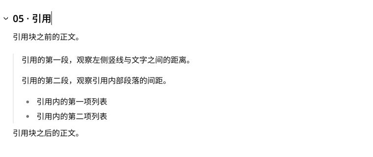

# 引用竖线与容器圆角独立

2026-10-28。引用块使用 8px 容器圆角后，原来的左侧边框随圆角弯曲，端点向内收。

将原边框保留为透明占位，使用不响应鼠标事件的独立伪元素绘制完整 2px 竖线。竖线自身为直角，容器仍为 8px，选中层仍为 12px、四侧外扩 4px。共享样式同时覆盖阅读与编辑场景。

应用内浏览器对比单行和多段引用，宽高、内部 padding、2px 边框占位和文字起点均未变化；编辑器文字起点仍为容器左侧 18px（2px 边框 + 16px padding）。阅读场景继续使用原有 1em 内边距，随正文大小变化。测量见 `measurements.json`。

实际输入并撤销恢复正文，拖动引用到相邻段落下方后一次撤销恢复全部内容与顺序。新增桌面、窄屏浏览器回归覆盖编辑 / 阅读中的单行、多段、嵌套引用，检查竖线全高、独立直角、不拦截鼠标及选中层范围。

桌面 10 项、窄屏 5 项浏览器回归通过；Storybook 类型检查、相关 lint、生产构建、包体预算、设计清单及 diff 检查通过。

