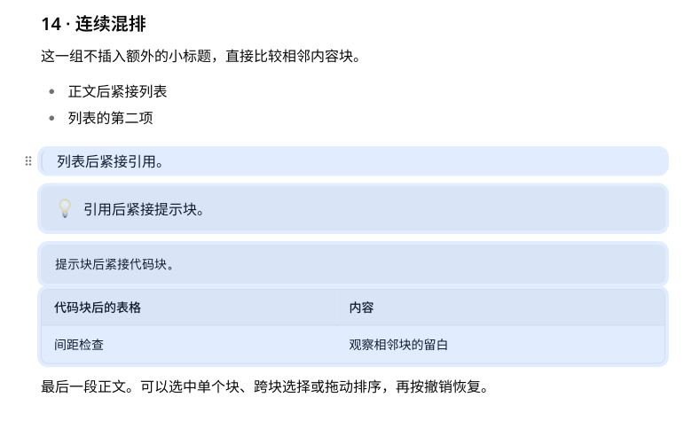

# 剩余内容块完整复查

2026-10-28。保留现有产品样式与交互，补充编辑、拖动撤销及全选几何回归。

- 范围：正文、六级标题、无序 / 有序 / 任务 / 嵌套列表、引用、带图标及无图标提示块、代码、Mermaid、标准 / 无表头 / 标题列 / 合并表格、公式、单张及并排图片、分隔线、脚注和原格式保留块。
- 内容容器默认圆角 8px，整块选中圆角 12px。正文、标题、列表没有独立容器背景，其行框选中圆角为 4px。
- 单块选择和全选逐块校验四侧外扩 4px、四角半径及覆盖层不拦截鼠标事件；代码与表格横向滚动仍保留外扩效果。单元格选择只覆盖格内。
- 每类可编辑文字内容输入后撤销，文档与内部尺寸、padding、背景全部恢复；每类顶层块通过拖动事件移动到末尾，一次撤销恢复原文、完整顺序及节点数量。图片覆盖自身拖动路径。
- 应用内浏览器实测 87 个块、223 个相关元素，选择 / 拖动撤销 / 编辑撤销前后，宽高、padding、圆角无差异。引用、提示块、代码、表格混合多选实测外扩均为 `[4,4,4,4]`，四角均为 12px。原始测量见 `measurements.json`。
- 真实鼠标将四个混合块一起拖动后，一次撤销恢复全部内容和顺序；代码与单元格输入后一次撤销恢复；点页边空白取消选中层、单元格焦点框与表格操作条。
- 共享测试 1,128 项、桌面浏览器 9 项、窄屏浏览器 4 项通过。首次窄屏整组运行在两项基础场景通过后停滞，终止该测试进程后，两项重点测试分别通过，最后窄屏整组独立重跑 4 项全部通过；未压制错误或改变产品逻辑。
- 共享 / Storybook 类型检查、相关文件 lint、diff 检查通过。本次未改变生产代码，无新增实体设备验收。

