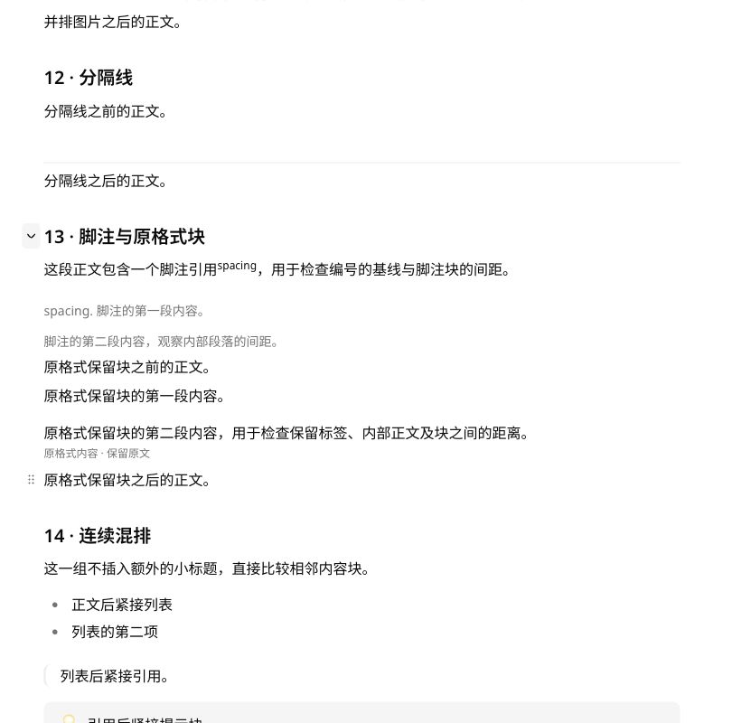

# 移除独立折叠内容与定义列表

2026-10-28。移除笔记正文的 `details` / `summary` 与 `dl` / `dt` / `dd` 专用节点、序列化分支、阅读渲染权限、专用样式及展示样例。标题章节折叠保留；属性面板与设置等应用界面使用的 HTML 语义标签不在本次内容块移除范围内。

已有 Markdown 中的原始 HTML 通过通用原格式保留块保存；阅读时去除这些标签、展示其文字，不生成可折叠区域或定义列表。回归测试验证节点不存在、阅读与编辑界面没有对应元素、邻近编辑及撤销不改写原始内容。

模拟页已删除原第 13 组，脚注与连续混排顺次改为第 13、14 组。应用内浏览器确认正文中对应元素数量为 0，并实际收起、展开第 13 组标题验证章节折叠正常。

验证通过：共享测试 1,127 项、UI 测试 448 项、桌面 Story 9 项、窄屏 Story 4 项；三套类型检查、lint、生产构建、包体预算、设计清单及 diff 检查。首次窄屏运行停滞，结束该测试进程后独立重跑通过，未修改测试逻辑或压制错误。

