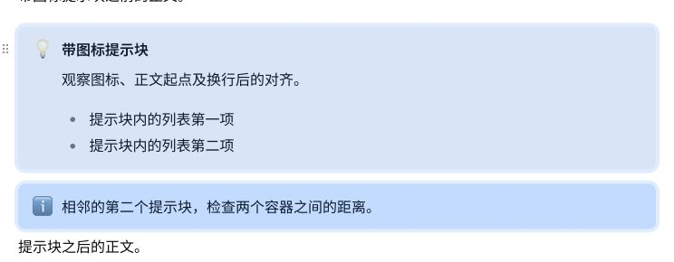
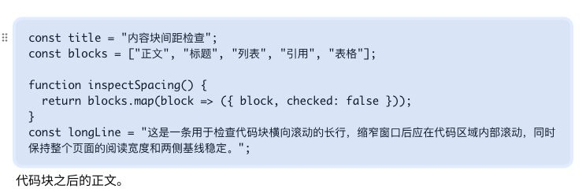
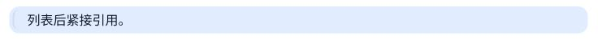

# 内容块选中范围与默认圆角

2026-10-28。最终规则：相对可见内容外框，整块选中层四边各向外 4px，无内缩；内容容器默认圆角 8px，选中圆角为自身圆角加 4px，即 12px。普通文字块的行框没有容器圆角，选中圆角为 4px。

## 实现与验证范围

- 选中层放在编辑器内容之外，按实际可见边界测量；文字行框扣除已有编辑留白，表格使用可见表格边框，图片、公式及 Mermaid 使用实际 NodeView 内容。
- 不修改字号、行高、padding、margin、宽高或换行。代码的 `12px 16px`、带图标提示块的 `12px 16px 12px 48px`、表格正文格的 `10.5px 14px` 均保留。
- 一条 SVG 路径绘制所有选中框，交叠区域只着色一次。覆盖层不响应鼠标事件，不进入 Markdown，不受表格或代码滚动容器裁切。
- 逐类覆盖正文、六级标题、普通 / 有序 / 任务 / 嵌套列表、引用、各类提示块、代码、标准 / 无表头 / 标题列 / 合并表格、公式、Mermaid、单张及并排图片、分隔线、脚注与原格式保留块。
- 单元格选择保留格内范围；整块单选、多块选择、全选、空白取消、输入和撤销、拖动和撤销均已回归。

## 检查结果

- 共享测试 1,125 项、UI 测试 448 项通过。
- 桌面 9 项、窄屏 4 项 Story 浏览器测试通过；新增两项全格式几何回归验证每侧 4px、容器圆角、选中前后内部尺寸与 padding 不变。
- 类型检查、UI / Storybook 类型检查、lint、生产构建、包体预算、设计清单及 diff 检查通过。
- 应用内浏览器真实鼠标验证：两个提示块整体拖动后一次撤销，恢复全部内容和顺序；单元格输入后一次撤销恢复；点页边空白隐藏选中层与表格操作条。
- 用户模拟页的表格、提示块、代码、图片和图形均实测为 8px。表格与代码的选中层实测四侧各 4px，圆角 12px。
- 用户标注的连续混排引用块也实测为默认 8px、选中 12px，四侧各外扩 4px，原有左侧 16px padding 保留。
- 使用模拟数据，未新增实体设备验收。

## 截图

预览：[内容块间距检查](http://127.0.0.1:5182/client.html?scenario=block-spacing)。
