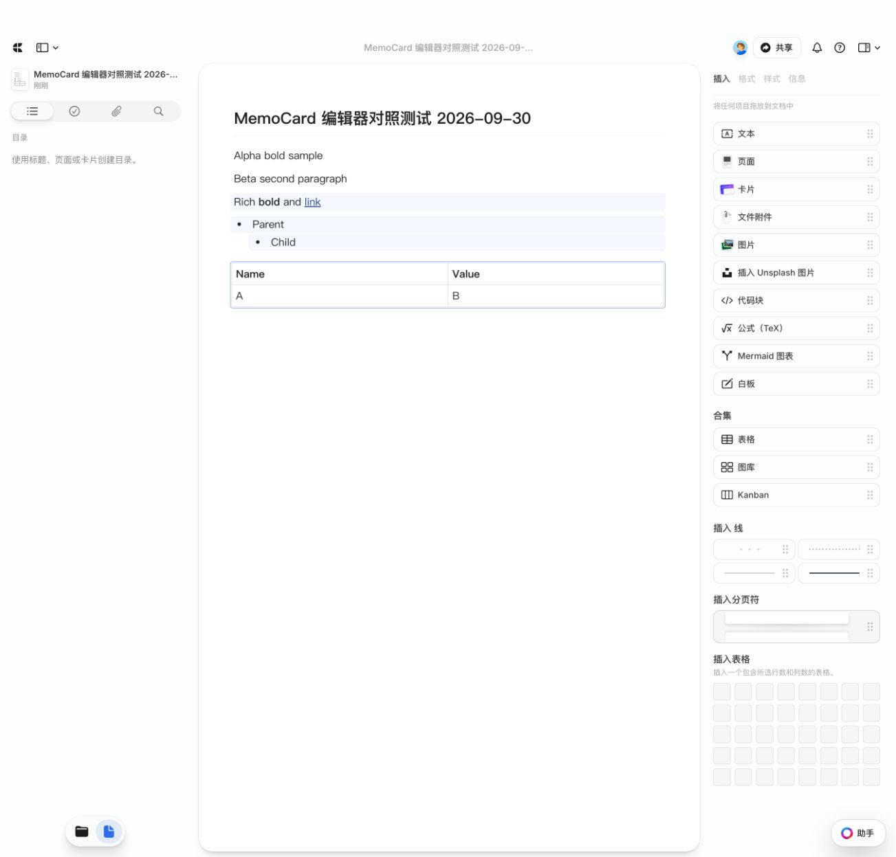
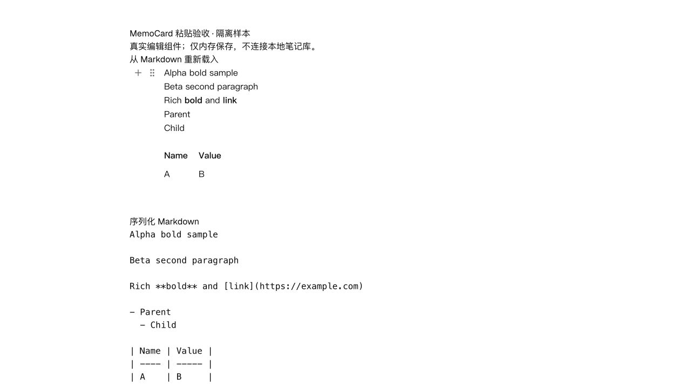
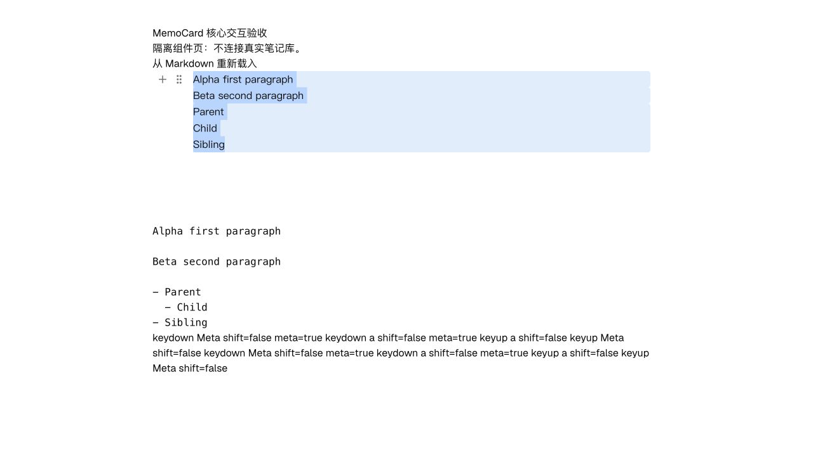
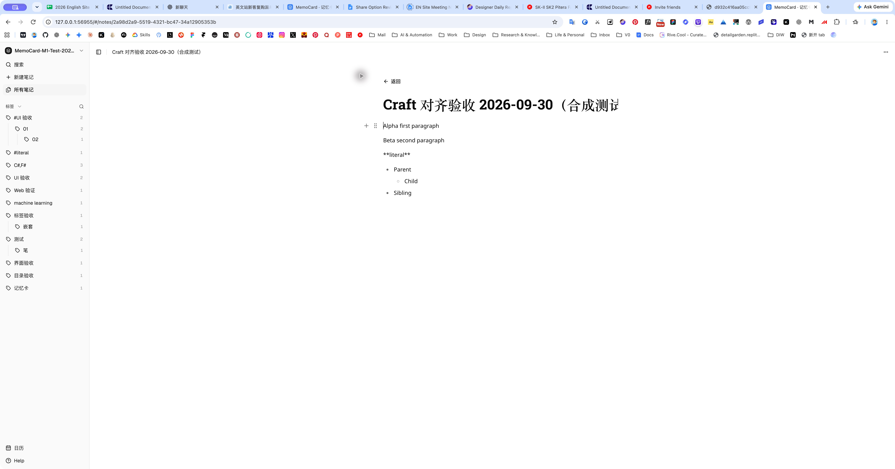
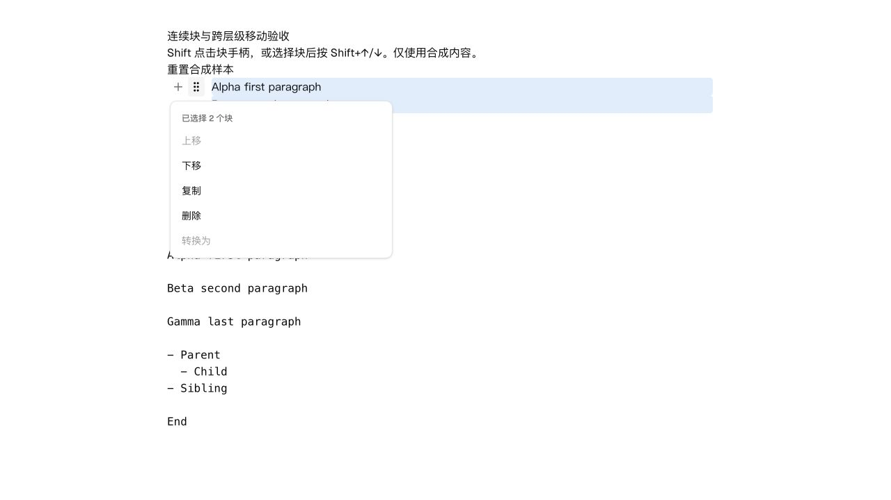
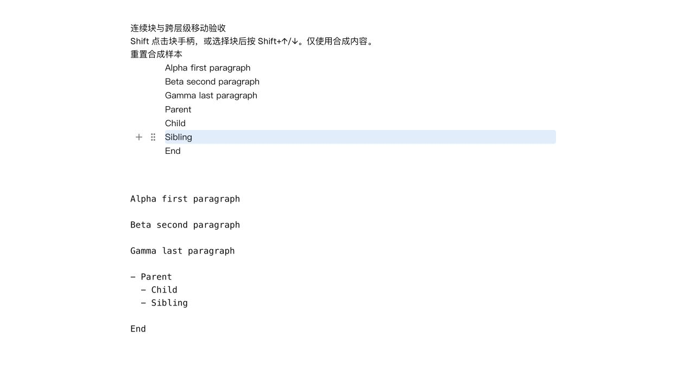
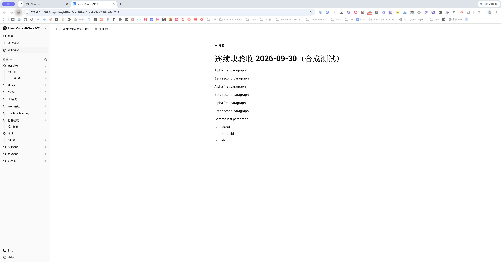
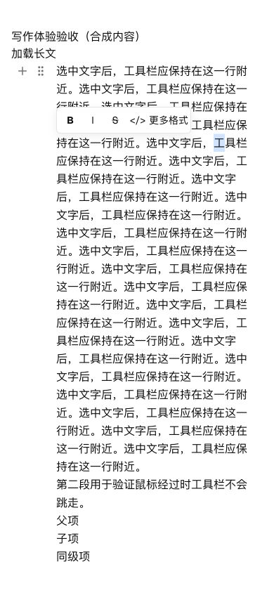
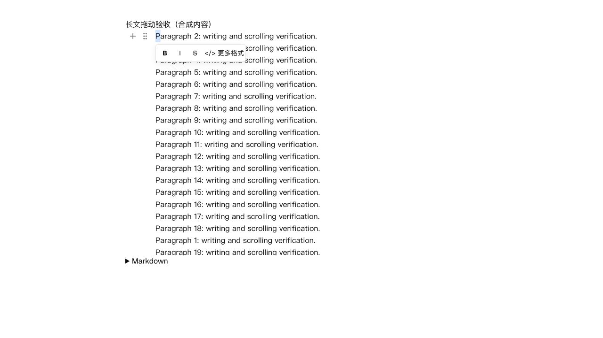
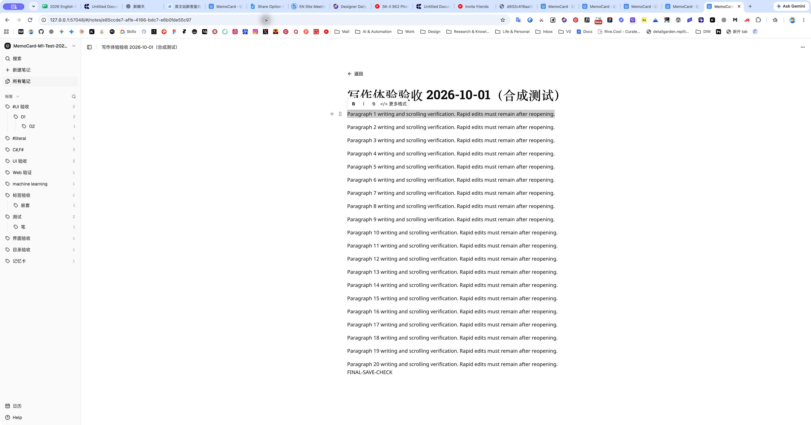

# Craft 编辑器研究与 MemoCard 优化计划

研究日期：2026-09-30。状态：资料研究、粘贴保真及本轮核心选择/块操作优化完成；本机服务已更新并完成真实文件写回验收。未覆盖行为见文末。

## 目标与证据标准

目标是对齐 Craft 的写作、块操作和视觉反馈，同时保留 MemoCard 的本地 Markdown 与 Obsidian 兼容能力。本文不是 Craft 源码复原，也不是全量功能复制计划。

- **现场观察**：研究阶段在已登录 Craft Web 的 Getting Started 文档只读检查 DOM、选择文字和查看工具栏；执行阶段另建合成文档，记录见文末。
- **官方说明**：工程博客、产品帮助和公开 API；每条结论保留来源及平台边界。
- **推断**：根据 DOM 与公开结构提出的架构解释，不视为内部实现事实。
- **待验证**：未操作的行为不得写成通过；文档描述也不能替代当前 Web 实测。

## 一、已经确认的实现线索

### 1. Web 文字层使用 Slate 的证据充分

现场页面出现 9 个 `data-slate-editor="true"` 根、33 个 `data-slate-leaf`，同时存在 `data-slate-node="value/element/text"` 和 `data-slate-string`。多个正文块及标题分别带有 Slate 编辑根，外层对应 `blockwrap-<UUID>`；卡片行存在 `blockrowwrap-<UUID>`。

据此高度确定当前 Web 文字层基于 Slate 或其衍生实现。不能确认版本、内部 fork、插件组合或 JavaScript 编辑器实例数量；不能外推到 Apple 原生客户端。

页面还存在 `spellCheckEnabler` 外层可编辑区域和 `sinktextarea`。只能记录它们存在，不能仅凭名称认定输入、IME 或跨块选择算法。存在 canvas 也不能证明文字由 canvas 绘制。

**架构推断**：多个块级文字编辑区域之外，有负责文档结构、布局与块交互的上层逻辑。跨编辑区域的选择、焦点和撤销如何协调，尚无源码证据。

### 2. 块与页面是结构关系

官方将段落视为块，包含嵌套内容的块可以成为页面，卡片是页面入口的一种呈现。分组会将多个块组织到新的父块下；同空间内移动块保留块链接。[S1]

这对 MemoCard 的启示是：列表缩进、普通段落缩进、子页面与卡片不能混成一个“嵌套”功能。第一轮仅优化现有 Markdown 可表达的结构；子页面与卡片先定义文件映射再决定实现。

### 3. 文字编辑与块选中存在不同操作上下文

官方快捷键区分：Return 编辑选中块、Esc 结束编辑，块焦点下 Space 在下方插入；块移动、复制、缩进另有命令。官方也注明部分平台快捷键能力不同。[S2]

现场选中正文短语后出现高亮、粗体、斜体、删除线、代码、链接、公式、提及与评论工具栏。尚未实测 Esc 后的块状态、重复全选、Shift 多选和跨块文字选择。

**建议**：先写清文字光标、文字范围、单块、多块、菜单、拖动、IME 组合输入之间的转换规则。不要为了模仿快捷键而直接覆盖浏览器或 ProseMirror 的默认行为。

### 4. Slash 菜单按上下文提供命令

官方说明菜单可用于空块、正在编辑的块及选中块；键盘可浏览子菜单；表格单元格中显示相关操作，内容会随上下文和平台变化。[S3]

因此，MemoCard 的插入菜单、块转换和格式工具需要共用明确的目标与可用性规则。只在确实复用时提取命令逻辑，不预先建设通用命令框架。

### 5. 剪贴板是独立转换层

Craft 工程文章披露 Apple 端由内部块转换为 NSAttributedString，再生成 HTML/RTF，并修正行内样式及嵌套列表输出兼容性。[S4]

这是苹果端实现资料，并非 Web 的实际粘贴优先级。它证明仅支持纯文本不足以覆盖跨应用格式保真；并未证明任意格式无损。

### 6. 保存和同步与 UI 分离

2024 年工程文章描述：移动端使用 Realm 本地存储，自研同步服务采用 Socket.IO 与 PostgreSQL，并将 UI 与数据平台 API 分开。[S5] 不据此推断其现今冲突算法是 CRDT、OT 或某个现成库。

当前帮助文档已说明 Web/Windows/Android 支持离线，并按打开的文档缓存，区别于原生端的空间同步；刷新、存储回收和多端离线均有条件。[S6] 旧文章的“Web 主要在线”只能视为历史架构描述。

### 7. 视觉模型与内容格式分开看

官方区分文字/块样式与页面样式。[S7] API 分别暴露块 ID、文字、列表、缩进、卡片布局和子内容字段，但公开 API 不等于完整内部存储。[S8] Markdown/TextBundle 是导出能力，不代表以普通 Markdown 为原始文档模型。[S9]

## 二、MemoCard 当前差异（代码静态核对）

| 范围 | 当前实现依据 | 判断与限制 |
|---|---|---|
| 正文模型 | `apps/ui/src/RichMarkdownEditor.tsx` 的 `useEditor` | 一个 ProseMirror 正文编辑器；不因 Craft 使用 Slate 就判定必须更换 |
| 粘贴 | 同文件 `handlePaste` | 读取 text/plain 并按 Markdown 解析，未采用外部 HTML 格式；是明确优先项 |
| 拖动 | `apps/ui/src/rich-blocks.ts` 的 `moveRichBlock` | 限制同一父级；不能描述为已支持跨容器拖动 |
| 选择 | RichMarkdownEditor 的 TextSelection/NodeSelection 用法 | 有文字及单节点选择基础；多块选择的完整产品规则需进一步核对和实测 |
| 源文保护 | `apps/ui/src/wysiwyg-markdown.ts` | 保留顶层原文与指纹；修改列表时可能重新生成整个列表，不是任意语法逐字无损 |
| 保存 | `apps/ui/src/editor-session.ts` | 650ms 防抖、串行保存、草稿恢复和哈希冲突；应作为改动约束保留 |
| 测试 | `RichMarkdownEditor.test.tsx`、`docs/EDITOR_ACCEPTANCE.md` | 已有拖动取消、撤销等自动化；真实 IME、触屏和跨块场景仍需独立验收 |

已有文档包含旧 CodeMirror 阶段记录，应以当前 Tiptap 源码及文档末尾更新为准。本次没有重跑应用测试，不复述历史通过数作为当前验证。

## 三、优化顺序与验收门槛

### 阶段 0：先补行为基线，再确定实现范围

使用单独的合成测试文档，在 Craft Web 与 MemoCard 测试库中跑同一组操作；不改真实笔记。记录应用/浏览器/日期、初始内容、动作、实际结果、截图和保存后的内容。当前 Craft 证据以 Web 为准；macOS 与 iOS 标记为文档参考或待实测。

| 编号 | 实测场景 | 必须记录的结果 |
|---|---|---|
| A1 | 点击文字、选择短语、Esc、Return | 光标/文字选区/块选中如何转换，焦点落在哪 |
| A2 | 第一次和第二次全选、Shift 点击多块 | 全选范围、连续或不连续选择、工具栏目标 |
| A3 | 从段中向后跨两段选择，再反向选择 | 部分文字与整块的边界；复制是否多出或漏掉内容 |
| A4 | 段首/中/末 Enter、Shift+Enter、Backspace | 拆分合并后光标及样式；空列表退出与子列表处理 |
| A5 | 块上下移动、跨列表拖动、拖出编辑器、Esc | 有效落点、层级、取消是否零修改、自动滚动 |
| A6 | 插入菜单搜索、子菜单、无结果、退出 | 操作目标稳定、键盘路径、取消后正文保留 |
| A7 | HTML 表格/嵌套列表、Markdown、纯文本互相粘贴 | 格式、链接、图片、空行；无格式粘贴与普通粘贴分开 |
| A8 | 移动、转换、粘贴后撤销/重做 | 一次用户操作对应的历史边界及选区恢复 |
| A9 | 真实中文输入法确认、取消、候选选择 | 组合输入期间不触发结构操作、不丢字；不能用自动填字代替 |
| A10 | 长文末尾操作、滚动、缩放与窄屏 | 工具栏不遮挡、落点不漂移、正文可滚动 |

阶段 0 的输出是行为差异表。尚未测出的 Craft 行为不得默认照搬 Notion 或 Slate 示例。只有关键规则明确后才推进相应代码。

### 阶段 1：先修内容保真与保存风险

按 A7/A8 建立回归样本。设计外部 HTML、普通文本和 Markdown 的粘贴判定，保留显式无格式粘贴；经过 schema 解析与安全 URL 处理，不能直接信任外部 HTML。是否需要自定义内部剪贴板格式由样本决定。

验收：中文、链接、任务列表、表格、图片和脚注等覆盖样本保存重开后语义正确；未修改块维持源文；撤销恢复导入前内容；原有草稿与冲突处理继续有效。纯文本中类似 Markdown 的字面量要有明确处理规则。

### 阶段 2：统一选择与块操作

以 A1–A5 的结果定义状态转换，优先在 ProseMirror 选区/事务体系内实现，避免另一套文档状态与它竞争。稳定区分文字选择与块选择，再支持需要的多块操作。跨层级移动先覆盖嵌套列表，不承诺任意页面/卡片嵌套。

验收：正反向跨段选择正确；块操作不误改部分文字；移动保留子列表与行内格式；非法落点不修改；取消无副作用；单步撤销/重做回到正确顺序、层级和焦点。一次只交付能独立验收的一组行为。

### 阶段 3：命令、焦点与排版

依据 A6/A10 对齐上下文菜单、工具栏定位和键盘路径，再调整行宽、标题层级、块间距、手柄和落点反馈。沿用当前用户字体/字号配置；只有实际观察记录后才确定视觉参数。

验收：菜单搜索不误触 IME；菜单打开时目标稳定；取消及执行后焦点可预测；长文末尾和窄屏不裁切；无选择时不常驻冗余工具栏。共享逻辑仅在多处使用时提取。

### 阶段 4：整体验收与是否换内核的决策

每阶段运行相关编辑器/序列化/保存测试；交付前执行仓库 `pnpm verify`，涉及原生桥接或服务时增加对应构建与集成检查。浏览器测试验证当前服务的真实渲染、日志、保存重开及文件内容；Mac 服务关联 Web、独立浏览器目录模式、真实原生输入分别记录。

只有在同一关键场景下，现有内核无法可靠实现、替代原型可以通过且 Markdown/保存适配成本可接受时，才提出迁移。使用同一套样本比较 BlockNote/Yoopta，不凭演示外观选择。当前结论是暂保留内核，非永久排除迁移。

## 四、第一轮明确不包含的范围

卡片/子页面的文件映射、任意块持久 ID 与跨笔记引用、白板、Collections、多人 CRDT、完整页面主题暂列为后续设计项。原因是它们涉及新的内容模型或产品能力，不应由“对齐 Craft 手感”自动推导为必须实施。

第一轮成功标准：核心写作与块操作具有明确可复现行为；未出现内容丢失或保存回归；每个交互结论有平台和测试证据。不以像素相似或单元测试数量代替体验验收。

## 官方资料索引

- S1 [Documents, Pages, and Blocks](https://support.craft.do/en/introduction/documents)
- S2 [Keyboard Shortcuts](https://support.craft.do/en/introduction/shortcuts)
- S3 [Slash Menu](https://support.craft.do/en/introduction/slash-menu)
- S4 [The Challenges of Cross-App Copy-Paste and Our Solutions](https://www.craft.do/blog/the-challenges-of-cross-app-copy-paste-and-our-solutions)，Apple 平台实现披露。
- S5 [The story of Craft's in-house sync protocol](https://www.craft.do/blog/in-house-sync-protocol)，2024-12-30，历史架构。
- S6 [Working Offline](https://support.craft.do/en/introduction/offline)，本次访问的当前产品说明。
- S7 [Styling](https://support.craft.do/en/write-and-edit/styling)
- S8 [Craft Space API](https://connect.craft.do/api-docs/space)
- S9 [Export to PDF, Word, and Markdown](https://support.craft.do/en/import-and-export/export/document)
- S10 [Csabi's journey](https://www.craft.do/blog/csabis-career-journey)，Web 团队 React 背景。
- S11 [Slate Editor](https://docs.slatejs.org/api/nodes/editor)、[Operations](https://docs.slatejs.org/concepts/05-operations)，解释底层概念，不是 Craft 自研实现证据。

## 仍缺少的证据

Craft Web 的全部跨块操作、真实中文 IME、拖动取消、跨应用完整剪贴板载荷、协同合并算法、当前原生编辑内核和性能测量未完成验证。公开资料未提供可确认的完整 Craft 编辑器源码；同名第三方 GitHub 项目不能充当官方源码。尚未验证的行为继续按阶段 0 采样，不直接将推断写入产品代码。

## 首批执行记录（2026-09-30）

本批范围：A7 富文本粘贴、A8 粘贴历史边界；其余阶段仍待执行，不能视为全部 Craft 对齐完成。

- Craft Web 新建合成文档「MemoCard 编辑器对照测试 2026-09-30」。同一 HTML 样本含粗体、链接、父子列表和 2×2 表格；实际生成格式化文本、列表、表格，单次撤销移除粘贴内容，重做恢复。文档 ID：`710434b8-24a3-4f71-858e-04a9b3c41fe3`。没有修改 Getting Started 或真实笔记。
- MemoCard 旧实现强制读取 `text/plain`，对应回归用例先失败。修复后 HTML/内部剪贴板使用 ProseMirror 已解析的 slice；普通纯文本沿用 Markdown 解析；关闭额外 Markdown paste rules，避免 HTML 字面量再被解释。
- Shift 粘贴和代码块走字面量路径；空剪贴板不删除选区；schema 阻止脚本节点和 javascript 链接进入文档。单元测试覆盖这些路径。
- 浏览器实测发现回车后粘贴会与回车共享撤销历史，现为粘贴前后建立历史边界。再次实测撤销保留此前回车，重做恢复粘贴内容。
- 使用真实 RichMarkdownEditor 的临时隔离页验证：富文本粘贴 → Markdown 序列化 → 销毁重建编辑器，粗体、链接、嵌套列表与表格保持。控制台没有 error/warn。临时验收页已清理。
- 自动化浏览器发送 Cmd+Shift+V 后仍表现为普通 Markdown 粘贴；键盘事件单元测试通过，但不能据此宣称真实系统无格式粘贴已验收，需在实际 Mac/浏览器按键复核。
- 本批未更新正在运行的已安装 MemoCardService，未将隔离组件页当作本地文件保存验收。真实库写回/重开、原生 IME、跨块选择和跨层级拖动仍未验收。

证据：

最终检查：`pnpm verify` 退出码 0；UI 26 个测试文件、284 个测试通过（本批新增 5 个编辑器回归测试），原生/网络/本机 Web 检查、构建和 bundle budget 均通过。构建仍提示部分 chunk 超过 500 kB，不影响现有 bundle budget 检查。`git diff --check` 通过。

## 本轮目标与执行结果（2026-09-30，第二批）

目标：在既有 Markdown 编辑内核上，完成可复现的段落/全文选择、块菜单目标、块操作撤销与焦点优化，解决无格式粘贴验证疑点，并在真实本机服务验证写回。该目标不等同于全部 Craft 功能完成。

| 验收项 | 结果与证据 |
|---|---|
| Craft 选择基线 | 合成文档中第一次 Cmd+A 只选当前段落文字，第二次选择全部正文块；Escape 清除选择；已通过现场截图观察。 |
| MemoCard 选择反馈 | 第一次 Cmd/Ctrl+A 选择当前文本块，第二次采用 ProseMirror AllSelection 并高亮顶层块；Escape 返回光标，不改正文。表格保留既有单元格选择快捷键。行内原子节点保留属性编辑入口。 |
| 菜单目标 | 光标在另一段时，打开当前手柄对应菜单会切到该块，避免属性改到旧光标处；已有同块文字选区保留。 |
| 嵌套列表 | 修复 NodeSelection 位于列表项起点时被识别成外层列表的问题；Parent 连同 Child 移动、撤销和重做通过浏览器实测。当前仍限同一父容器排序。 |
| 历史与焦点 | 移动、复制、删除与前后输入分开撤销；复制/删除/取消菜单后恢复编辑器焦点。 |
| 命令菜单 | 无结果时 Enter 不删 slash 原文；搜索菜单 Escape 后恢复编辑器焦点。组合输入中的快捷键不会改变选择，回归测试通过。 |
| 无格式粘贴 | 诊断页记录内嵌浏览器 Cmd+Shift+V 只有 paste 事件、没有修饰键事件。改用真实 Chrome 原生按键验证后，**literal** 保持星号，重开后仍保留，磁盘正确写成转义星号。该疑点已关闭。 |
| 本机服务 | pnpm build:service、install:service、签名校验通过；已更新安装并重启，当前监听 127.0.0.1:56955，旧 56866 不再使用。Chrome 已通过应用授权链接打开原 MemoCard-M1-Test-20260928 库。 |
| 真实保存 | 新建「Craft 对齐验收 2026-09-30（合成测试）」；出现“已保存到本地库”，刷新后内容一致，直接读取磁盘 Markdown 核对了段落、转义星号、父子列表与 YAML 标题。未修改其他测试笔记。 |
| 自动检查 | pnpm verify 退出码 0：26 个 UI 测试文件、291 个测试通过，原生/网络/本机 Web、构建、bundle budget 通过；补强移动后输入的历史测试后，编辑器 31 项回归再通过。 |

真实文件：`/Users/divikwu/Library/Mobile Documents/com~apple~CloudDocs/MemoCard-M1-Test-20260928/notes/2a98d2a9-5519-4321-bc47-34a12905353b.md`。

后续目标：跨层级列表拖拽与非法落点、连续多块的移动/复制操作、长文窄屏浮动工具栏、真实中文输入法候选确认/取消。当前测试覆盖组合事件保护，但未实际操作中文候选窗口，不声称原生 IME 已验收。独立浏览器目录授权模式未在本批重新验证；本批真实库验证的是服务关联 Web。

## 第三批：连续块操作与列表跨层级移动（2026-09-30）

目标：在现有 Markdown 内核上补齐连续多块复制/移动/删除与独立撤销；允许兼容列表项跨层级移动，阻止移入自身后代；验证跨段文字替换和保存边界。

- 新增 ProseMirror `BlockRangeSelection`，支持 Shift 点击块手柄和 Shift 上下箭头扩展连续选区；菜单显示选中块数，批量移动、复制、删除保持顺序和子结构。
- 跨父容器移动仅允许兼容列表项；拒绝自身后代、过期位置、无变化落点及不兼容类型。移走最后一个子项时移除空列表，撤销恢复原层级及 Markdown。
- 浏览器实测了连续两段下移/撤销、子项移到外层、外层项移入已有子列表。修复了真实 Radix 菜单 Escape 未恢复编辑焦点的问题。组件页控制台无 error/warn，临时验收页已清理。
- 自动测试覆盖正反向跨段替换、连续块剪贴板、选区映射、批量结构操作、跨层级边界以及复制后撤销/重做的内容通知。额外集成测试覆盖撤销正在保存时发生重做，最终保存完整重做结果。
- 已构建、签名校验并安装第三批服务，监听 `127.0.0.1:56974`；真实 Chrome 在合成笔记「连续块验收 2026-09-30（合成测试）」执行复制/撤销/重做。文件 `notes/b1f8ef2e-d289-45ba-9e3a-f3984e8ad7c3.md` 已直接核对含两组 Alpha/Beta、Gamma 和父子列表。
- 曾观察到一次页面重做后磁盘仍为撤销内容；后续同路径复测正常，保存进行中的集成回归也通过，尚未定位首次差异原因，不能声称已修复保存故障。最终刷新后的页面检查因 Mac 锁屏且自动解锁失败中止；保留该人工复核项。
- 中文 IME 候选确认/取消、触摸操作、独立浏览器目录模式以及长文窄屏工具栏仍未在本批实测。

最终全量检查：`pnpm verify` 退出码 0；27 个 UI 测试文件、307 个测试通过，原生 34 项测试、网络/本机 Web 检查、类型检查、lint、构建和 bundle budget 通过。`git diff --check` 通过。目标保留为进行中，待解锁后完成上述刷新复核。

### 续验收（2026-10-01）

Mac 解锁后，首先重新打开同一真实笔记，确认前一晚重做后的两组 Alpha/Beta 与嵌套列表仍在。再次通过真实 Chrome 原生按键及菜单执行连续两块复制 → 撤销 → 重做；页面出现三组 Alpha/Beta，随后直接读取磁盘核对三组正文和父子列表。点击浏览器刷新按钮，等待页面重新加载，三组正文与列表仍完整保留。保存链路最终复核通过，锁屏阻塞已解除。

首次差异的原因未被定位，不将本轮描述为修复了一个确定的保存竞态；重复真实验收以及保存进行中的撤销/重做集成回归均未再复现。目标范围内的连续块操作、兼容列表项跨层级移动、非法落点保护、跨段替换/撤销、Markdown 保真、全量检查与浏览器验收已完成。真实中文 IME 候选操作仍未实测，本轮只确认组合事件保护并记录该边界。

## 第四批：日常写作体验（2026-10-01，进行中）

目标：验证中文组合输入与快速保存、段落/列表边界、长文和窄屏工具栏及拖动反馈；仅修复已复现的问题，保留 Markdown 内核。

- 文字格式工具栏原先复用悬停块手柄的定位，选中文字后经过另一段会跳走。回归先失败（73px 跳至 373px）；现将文字工具栏独立定位到文字选区所在行，并在编辑区尺寸变化时重新计算。
- 新增中文段落 Enter 拆分、段首 Backspace 合并及光标位置、空列表项 Enter 退出且保留后续段落的回归验证。
- 拖动边缘自动滚动时原先只更新 scrollTop，不重新判断指针下的落点。现记录指针坐标并在滚动帧重算落点；回归验证滚动后失去有效落点时清除旧指示线。实际长文拖动的完整浏览器复核待继续。
- 临时真实 RichMarkdownEditor 页面在 390×844 下验证工具栏位于 x=80…272，页面 scrollWidth=390；300 段合成中文文档的最后一段可输入、选字及显示格式工具栏，控制台无 warn/error。这是功能验收，不是输入延迟或性能基准测试。
- 浏览器自动化的 Cmd+Down/End 未可靠移动到预期文末，改为点击可见的末段定位；不把这种自动化行为认定为产品键盘缺陷。
- 原生中文 IME 候选确认/取消尚未实测；已覆盖组合期间快捷键保护。快速保存边界沿用 Editor/EditorSession 中较早保存期间继续编辑、撤销/重做、最新恢复内容与 hash 更新的集成回归。
- 首次全量检查出现 5 项页面等待/超时失败，涉及 App、侧栏、emoji 和主题；4 个文件单独复跑 51 项全通过，最终全量结果另记。
- 浏览器工具随后报告当前 URL 禁止 Computer Use，并终止该操作会话。没有尝试绕过限制；临时页面文件和 Vite 进程已清理。新版服务仅完成构建，尚未替换当前运行服务，真实库保存重开验收未完成。

第四批最终自动检查：`pnpm verify` 退出码 0，27 个 UI 测试文件、311 项测试及 34 项原生测试全部通过；网络/本机 Web、类型、lint、构建、bundle budget 通过。`pnpm build:service`、构建产物签名校验和 `git diff --check` 通过。目标仍进行中，剩余真实浏览器验收需解除上述访问限制。

### 第四批恢复验收（2026-10-01）

浏览器恢复为无可用窗口后，通过 `memocard serve` 正常打开本地授权页面，未访问此前受限制的页面。第四批初版安装后监听 57011，创建合成笔记 `e85ccde7-affe-4166-bdc7-e6b0fde55c97`，标题「写作体验验收 2026-10-01（合成测试）」。真实 Chrome 直接输入 20 段英文后，在末尾快速编辑、撤销、重做；磁盘确认 20 段及 `FINAL-SAVE-CHECK`，浏览器刷新重开后仍一致。

原生工具的剪贴板注入超时，直接输入中文也未完整产生预期文本，已用全选替换为英文合成样本。没有将上述工具行为定性为产品输入缺陷，也不将直接填字当作真实中文输入法验收；中文 IME 候选确认/取消仍待实测。

真实页面发现第一行选区被工具栏覆盖，进一步调整：依据选中文字行定位，允许显示在正文上方；当视口或滚动容器顶部空间不足时显示在选区下方。浏览器验证容器顶部 64px、选中文字底部约 90px、工具栏顶部 94px，无覆盖且未被裁切。

50 段、480px 高滚动容器中实测拖动首段到下边缘，顺序正确改变、释放后指示线消失；控制台无 warn/error。工具提供一次完成的拖动，未验证原生鼠标长时间停在边缘的过程；该过程的重算与无效落点清除由回归测试覆盖。临时验收页面和进程已清理。

第四批最终交付：新增第一行空间不足的工具栏回归后，最终 `pnpm verify` 退出码 0（27 个 UI 文件、312 项测试；34 项原生测试；其余构建/网络/本机 Web/bundle 检查通过）。重新构建、安装并校验签名，最终服务监听 `127.0.0.1:57048`。重开上述笔记，20 段及保存标记保留；在最终安装版本追加 ` verified` 后，磁盘确认 `FINAL-SAVE-CHECK verified`。第一行格式工具栏显示于选区上方、不再覆盖选中文字。检查记录：`/tmp/memocard-writing-release-verify.log`、`/tmp/memocard-writing-service-final.log`。

本批完成了已声明的实现、自动检查和浏览器功能验收；未将原生中文 IME 候选、长时间停驻拖动或输入延迟基准标为实测通过。独立浏览器目录模式未重验。仍不代表整体达到 Craft 同等体验水平。

