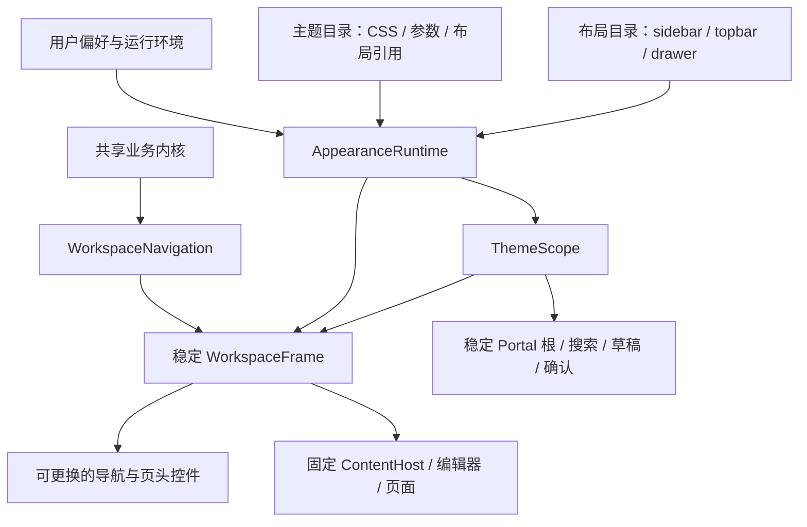

# Web 多主题架构方案：视觉主题与布局复用

状态：A–D 已在当前工作树实现，验证记录见第 11 节。日期：2026-11-04。

范围：项目随版本发布的内置 Web 主题；保持现有经典、简约的样式和功能。H5 采用明确的响应式布局；原生外框与协议保持现状。本轮实施组合目录、稳定框架、共享导航和浮层作用域；偏好 v2 与主题自身字体/圆角默认值留待真实需求。

## 1. 核心决策

**主题包 = 视觉样式与参数 + 布局引用。**

主题负责外观，Layout Adapter 负责结构与导航交互；业务内核、页面、编辑器和工作区宿主共享。多个主题可以复用同一个布局。用户仍只选择「界面主题」，不新增独立的布局设置。

新增纯视觉主题的正常路径是增加主题配置、CSS 和验收登记；只有出现新的导航结构或交互时，才增加 Layout Adapter。禁止为每个主题复制整套应用、编辑器或业务状态。

Obsidian 官方的公开主题机制以 CSS 变量与样式为主，推荐低特异性选择器。这里借鉴其视觉契约，再为 MemoCard 已有的侧栏/顶部栏差异增加受控布局 Interface；不声称复刻 Obsidian 的内部应用架构。[官方主题规范](https://docs.obsidian.md/Themes/App%20themes/Theme%20guidelines)

## 2. 用户模型与组合关系

| 界面主题 | 视觉 | 桌面布局引用 | 窄屏布局引用 | 状态 |
| --- | --- | --- | --- | --- |
| 经典 / classic | 当前基础视觉 | sidebar | drawer | 已有产品 |
| 简约 / minimal | 当前简约视觉 | topbar | drawer | 已有产品 |
| paper | 测试 CSS，改变菜单间距与工作区宽度 | topbar | drawer | 测试 fixture，不加入产品 |
| experimental | 测试视觉 | experimental | drawer | 测试布局 fixture，不加入产品 |

简约迁移后在窄屏仍保持当前抽屉外观与触摸尺寸。将布局改成 drawer 不等于把用户选择改成 classic；当前视觉参数必须在该组合下与迁移前一致，不能把桌面标签菜单的 36px 行密度传播到移动抽屉。

浅色/深色/跟随系统、强调色、已有字体与圆角、正文排版、卡片/列表选择继续作为跨主题用户偏好。主题不能通过隐藏必需入口或改变权限、保存和删除规则制造差异。

## 3. 职责与真实 Seam

| Module | 拥有的 Implementation | 对外 Interface 与不变量 |
| --- | --- | --- |
| 现有业务内核 | 查询、保存、草稿、权限、路由、文件桥接 | 布局和主题只调用受控动作，不新增 bridge 调用或业务 store |
| AppearanceRuntime | 主题/布局解析、资源加载、竞态、提交、回退 | 输出一份已应用外观与选择操作；请求与已应用状态分开 |
| 主题目录 | 轻量元数据、响应式布局引用、视觉 CSS/参数 | 提供视觉资源，不导出 React 页面、保存逻辑或布局控制器 |
| 布局目录 / Layout Adapter | 侧栏、顶部栏、抽屉的导航及相应页头控件 | 接收同一中立导航模型，不接收完整 AppViewState |
| WorkspaceFrame | 固定导航区、页面宿主、滚动容器、布局语义属性 | 不随主题/布局改变自身类型、ContentHost 路径或 key |
| WorkspaceNavigation | 共同动作描述、目的地、选中态、可用性投影 | 保留现有控制器守卫，两个导航出口复用相同行为 |
| ThemeScope | 主页面、局部示例、Portal 的样式作用域 | Portal 容器身份稳定，局部覆盖明确，不依赖单一全局 html |
| WebAppearance / 排版偏好 | 持久化、校验、系统明暗、跨标签同步 | 保留既有存储语义；主题提交不覆盖其他同时变化的偏好 |

侧栏与顶部栏是已存在的两个 Layout Adapter，证明该 Seam 有真实用途；纯视觉主题复用它们。Interface 吸收重复的行为决策以获得 Depth、Locality 与 Leverage，不为单次字段转发创建新的 Module。



## 4. 注册与窄 Interface

主题与布局是两个逻辑目录，可先放在同一注册文件中，避免过早增加文件层级。静态元数据常驻，视觉与布局 Implementation 按需加载。ID 使用稳定英文键，文案可改名；注册校验确保引用有效。

生产类型位于 [contracts.ts](../apps/ui/ui/web/appearance/contracts.ts)，目录位于 [catalog.ts](../apps/ui/ui/web/appearance/catalog.ts)。布局 ID 从静态目录推导，生产主题引用通过类型校验；运行时另外检查视口支持并提供回退。

```ts
type LayoutAdapter = {
  TopNavigation?: ComponentType<WorkspaceNavigationProps>;
  SideNavigation?: ComponentType<WorkspaceNavigationProps>;
  NavigationControls?: ComponentType<NavigationControlsProps>;
};

type AppearanceResolution = {
  themeId: string;
  layoutId: string;
  themeFallback: "unknown" | null;
  layoutFallback: "unsupported-viewport" | null;
};
```

Runtime 另外返回加载中的 `pending`、失败的 `error`、选择与重试操作；已应用状态始终保持可用。颜色模式继续由既有 WebAppearance / PreviewMode 提供，再与解析结果一起写入作用域。

实际目录使用静态字面量 loader，不能把任意字符串拼成动态 import 路径。类型 ID 从目录推导；持久化的 requestedThemeId 允许保留未来或暂时不可用的 ID，不因当前目录不认识就覆写。

侧栏/抽屉尽量复用当前 AppSidebar 的呈现和触摸行为。顶部栏复用当前 WebTopNavigation 的呈现；双方改为消费 WorkspaceNavigationProps。需要的页头开关、集合标题开关和分隔线由布局出口提供，页面编排不再判断具体主题 ID。

Frame 始终拥有现有顶部导航区、侧导航区和内容区。Adapter 只能填充约定区域，不能包装或移动 ContentHost。两个导航区域均为空是注册错误。新内容展示出口必须由实际差异驱动，不开放任意 route-to-component 映射、无限 slot 或编辑器替换。

## 5. 结构、视觉与共享页面规则如何归属

| 内容 | 所有者 | 理由 |
| --- | --- | --- |
| 导航位于侧面还是顶部、抽屉开合及页头入口 | Layout Adapter | 改变结构与交互 |
| 工作区 grid/flex、滚动宿主、固定区域 | WorkspaceFrame + 布局 CSS | 保证内容树稳定 |
| 导航与集合/详情外框保持同宽 | 布局约束 | 由同一测量参数确保对齐 |
| 80rem 最大宽度、24/32px 外侧留白等数值 | 有消费者的视觉/布局参数 | 可以换主题数值，但不能破坏布局关系 |
| 导航选中表面、菜单间距、卡片表面与图文间距 | 主题视觉或共享呈现角色 | 复用导航结构时允许改变外观 |
| 首页列表自然收尾、所有笔记列表撑满 | 共享页面规则 | 当前两个主题均保持，不复制进主题包 |
| 笔记行宽、字号、行高、段距 | 既有正文排版偏好 | 主题切换不能改写阅读设置 |
| 权限、保存前校验、搜索、笔记库与草稿 | 业务内核 | 不属于主题差异 |

原 web-interface-theme.css 已拆分：根 flex/高度和详情外框规则由 layouts/topbar.css 按 data-workspace-layout 控制；minimal.css 仅提供主题参数。工作区宽度、菜单宽度/间距均有真实消费者，集合容器与导航/详情共用 --workspace-max-width。共享菜单呈现仍归布局组件维护。

沿用现有 `ui/theme.css`、palette 和 token registry。只增加有实际消费者的参数；为工作区最大宽度、留白、菜单密度等建立语义角色，不引入一个可配置任意 CSS/页面结构的 DSL。

## 6. 稳定工作区与导航行为

React 按类型、key 与树中位置关联状态。WorkspaceFrame、ContentHost、编辑器、QuickCapture、搜索和草稿宿主的结构身份固定，Grid/Flex 调整位置；禁止按 themeId 或 layoutId 更换外层组件类型或 key。[React 状态规则](https://react.dev/learn/preserving-and-resetting-state)

```tsx
// 禁止：更换 SelectedLayout 类型会重建内容子树。
<SelectedLayout key={themeId}><WorkspaceContent /></SelectedLayout>
```

只换视觉且复用同一布局时，保留导航实例和打开的弹层。更换布局时允许关闭旧导航的瞬时菜单、标签浏览弹层，并把焦点移到新导航的对应入口或稳定 main；搜索/草稿等业务对话框继续保留。

必须保留：当前笔记、未保存正文、选区与撤销历史、路由与筛选、捕获草稿、搜索查询和结果、恢复草稿状态、已有卡片/列表选择。布局改变会导致内容重排，不承诺逐像素滚动相同；不得主动滚回顶部，必要时恢复内容锚点。

WorkspaceNavigation 统一目的地、选中态、标签数据和共同操作描述，包括打开/创建/切换/刷新笔记库、重新授权、设置、回收站、搜索与草稿。主题无需知道操作如何执行。Adapter 可安排不同分组和位置；disabled 是呈现反馈，执行仍通过现有控制器进行权限和保存守卫检查。不增加通用命令总线。

## 7. 主题作用域与样式优先级

主页面与 Portal 使用同一已解析视觉主题、颜色模式、palette 和用户覆盖；布局结构样式只作用于工作区框架，不让 Portal 根变成 grid/flex 工作区。

职责分明的属性包括 `data-interface-theme`、`data-workspace-layout`、`data-ui-theme` 及已有 palette 属性。关键布局根据显式语义属性工作，减少根据偶然内部 DOM 的 :has 查询。内部组件确有用途的 :has 无须全部删除。

主题样式限制在自身作用域与稳定角色；布局样式限制在 layout 作用域。inactive 主题的 CSS 即使先下载也不能影响当前界面。复用公共基础，不建立 classic → minimal → newTheme 的继承链；不依赖 CSS 下载先后、复杂选择器或 !important 维持优先级。

样式解析顺序为公共基础 → 主题默认 → 选定颜色模式/配色的语义解析 → 用户明确覆盖 → 平台与无障碍约束。通过明确的变量输入和解析规则实现，不简单依赖导入顺序。主题不能改写用户选定的强调色、字体、圆角或正文排版。

[ThemeScope](../apps/ui/ui/components/theme-scope.tsx) 沿 React Context 传递已解析属性与变量，由各 Base UI Portal 原有的 DOM 根消费。Portal 继续挂载在滚动、overflow:hidden、transform 和 container-type 区域之外；切换主题只更新属性，不改 container 或 key。保留各 Portal 原有根，避免共享容器影响 Base UI 的 modal inert 与焦点管理。[React Portal](https://react.dev/reference/react-dom/createPortal)、[CSS 自定义属性](https://developer.mozilla.org/en-US/docs/Web/CSS/Guides/Cascading_variables/Using_custom_properties)

Shared Popover/Menu/Dialog/Select/Combobox/Tooltip/Sheet 与属性确认均接入最近作用域；局部 Dialog 的明暗覆盖继续传递给遮罩与嵌套弹层。富文本共享内核通过现有 create… 工厂注入带作用域的 Portal Adapter，src 不反向依赖 UI provider。委托 Tooltip 从实际锚点读取最近的作用域，避免取到外层全局明暗。

Storybook/Preview 的独立示例可各有作用域。既有 documentElement 外观写入保留兼容，局部作用域独立解析 palette 和字体/圆角输入；原生 palette 不消费 Web 专属布局参数。

## 8. 解析、回退与加载事务

主题回退与布局回退分开记录：

- 当前主题存在，窄屏改用它声明的 drawer：正常响应式解析，保留视觉主题和用户选择。
- 某布局不支持当前视口：选择该视口的共享布局，记录 layoutFallback，不重写 requestedThemeId。
- 主题未知或目标资源失败：保留当前可用组合；冷启动采用经典/共享抽屉，记录 themeFallback，保留 requestedThemeId。
- 原生宿主继续走原生外框路径，不因 Web 主题 ID 加载 Web 布局；已有颜色模式等按原协议工作。

一个 AppearanceRuntime 负责加载与提交：

1. 接到选择后记录目标，以 effect 生命周期使旧请求失效，保留当前可用视觉与布局。
2. 并行加载目标 CSS 以及引用的布局代码/CSS。已有布局资源直接复用；可选字体沿用现有回退与重试，不阻塞整个主题提交。
3. 仅当请求仍最新且必需资源成功时，一次性提交主题、布局与作用域属性，再保存用户主动选择。
4. 完成时合并最新外观偏好，不能用加载前捕获的旧对象覆盖刚修改的颜色模式或强调色。
5. 快速 A→B→C、窗口断点变化、跨标签更新和恢复默认都能使旧请求失效；迟到的完成/失败不改变当前状态。
6. 失败保留当前可用组合并提供重试；存储失败时会话选择仍有效。跨标签失败不把旧主题写回去覆盖另一标签的新选择。

import() 的迟到结果通过请求所属 effect 的失效标记忽略，不增加复杂取消框架。经典最小可用外框和移动抽屉属于启动基线，其余布局与主题增量按需加载。共享资源按只读目录身份与 loader 函数身份缓存；失败可重试，不创建插件安装/卸载生命周期。

资源检查同时覆盖默认首屏、各主题首次进入、共享布局复用和主题切换闭包。不能仅把资源移到动态 import 就宣称成本消失；当前 bundle 预算保持，正式压缩产物与请求数量均需验证。

## 9. 偏好保存与未来默认值

A–D 保留当前 v1 键及字段：`interfaceTheme` 存主题 ID，内部布局引用不单独持久化；`theme` 仍保存当前颜色模式。设置选项由主题目录生成。主题选择经加载事务提交，其他外观设置继续使用同一偏好 Module，避免两套写入者互相覆盖。

A–D 不新增“跟随主题”选项，不改变现有字体/圆角/排版优先级，不把恢复默认改成只重置当前主题。当前恢复外观默认仍回到经典及既有外观默认值，不删除正文排版、标签、草稿或库数据。

未来主题需要自己的默认字体/圆角时，才引入带版本的 v2 偏好，区分主题默认与用户 override；否则现有全量默认值会一直盖住主题默认。迁移必须读取原始 v1 对象，保留实际存在且有效的字段，包括恰好等于旧默认值的值；不能对 parse 后补齐的字段猜测用户意图。为确保旧用户迁移当次视觉不变，缺失但旧解析会补齐的字体/圆角值也保留为兼容覆盖；这只记录旧的有效外观，不声称用户主动选择过。用户明确选择“跟随主题”后才删除相应覆盖。全新安装采用空覆盖并使用主题默认。

v2 迁移为纯函数且幂等，v2 优先、v1/legacy 只读回退，不删除旧键，不长期双向同步。用户覆盖仍跨主题共享；正文排版继续使用现有 `memocard.typography.v1`。未知主题 ID 在内存与保存中保留，运行时回退与持久化选择分开；损坏值才采用安全默认。

## 10. 当前目录与新增主题流程

```text
ui/
  components/theme-scope.tsx    # 作用域及 Portal 属性
  components/theme-scope.css    # 局部字体/圆角输入绑定
  business/navigation-model.ts # 中立模型、共同动作与可用性
  web/
    WebAppView.tsx              # 共享页面编排，不判断具体主题 ID
    WorkspaceFrame.tsx          # 固定内容宿主与导航区域
    WorkspaceNavigation.ts      # 业务控制器向中立模型投影
    appearance/
      catalog.ts                # 主题与布局只读目录
      contracts.ts              # 组合与布局 Interface
      AppearanceRuntime.tsx     # 环境解析、资源加载、原子提交
      themes/minimal.css        # 简约视觉参数；经典直接复用基础视觉
    layouts/
      sidebar.tsx               # 侧栏/抽屉和现有页头按钮
      topbar.tsx                # 顶部导航出口
      topbar.css                # 顶部布局与共享导航呈现
```

结构规则依据布局语义属性；视觉资源依据主题作用域。drawer 复用 sidebar 实现，既有业务函数继续留在 src。测试专用目录通过 AppearanceCatalogProvider 注入，生产只读目录不暴露可变注册入口。

新增纯视觉主题：添加视觉增量与资源 → 登记 label、布局引用、CSS loader → 视觉/契约 fixture → inventory/token 归属登记。不得修改 App、编辑器、路由、桥接或新增主页面 themeId 分支。

新增交互布局：先定义当前真实需要的导航/页头 Interface，复用 NavigationModel 与 Frame，再登记 Layout Adapter；已有主题的行为必须继续通过契约测试。内容 DOM 确需不同的需求再单独讨论呈现 Seam，不预建一套页面插件系统。

## 11. A–D 实施与发布门槛

| 阶段 | 工作 | 完成标准 |
| --- | --- | --- |
| A：固定宿主与组合目录 | 主题/布局目录、resolver、稳定 Frame；经典与简约按现有映射迁入 | 两主题前后几何/外观/功能一致；v1/原生保持；页面无主题 ID 判断 |
| B：统一导航行为 | 中立 NavigationModel、共同操作与可用性；保留不同呈现 | 保存守卫、当前库操作、权限、重新授权、草稿、快捷筛选一致 |
| C：视觉与浮层 | 拆分结构/视觉 CSS、实际参数、ThemeScope/Portal、原子加载 | 样式不串扰；移动密度不变；局部/嵌套弹层与焦点通过 |
| D：扩展演练 | 测试专用第三视觉主题复用已有布局；测试专用新 Layout Adapter 验证真实布局出口 | 新视觉主题零新增导航 React；新布局不包裹编辑器；均不加入产品列表 |

D 的两个 fixture 分别验证常见视觉扩展与较少见的结构扩展；不把“第三套 React 导航”当作视觉主题可扩展的证明。测试/Preview 通过注入只读目录使用 fixture，生产目录继续只含经典和简约；不提供可变的全局运行时注册入口。

验收包括：

- 经典/简约 × 桌面/窄屏 × 浅/深色的迁移前后基线；当前主页/所有笔记高度、导航与详情外框宽度、菜单间距、logo 比例不变。
- 纯视觉切换和布局切换均保持 editor DOM/instance、未保存内容、selection、undo、路由、筛选、捕获草稿、搜索和恢复草稿状态；合理恢复滚动锚点与焦点。
- 同一布局被多个主题引用时复用同一 Adapter；不新增业务查询、自动保存触发器或每主题 store。
- 冷启动、慢加载、失败/重试、A→B→C、切换中修改颜色、跨标签、窗口断点、恢复默认、未知主题与存储拒绝。
- 所有布局出口经过同一组共同操作测试；展示层 disabled 不能替代控制器守卫。
- Portal、标签编辑、嵌套菜单、Dialog 遮罩、Select、Sheet、Tooltip 与局部主题一致；无裁切，键盘回焦、forced-colors、reduced-motion 正常。
- 320/390/767/768/1024/1440/1920 等视口无横向溢出，移动触摸尺寸和 safe area 保持；原生协议不变。
- 默认首屏与新增主题/布局入口的资源闭包在明确预算内；inventory、token registry、生成消费索引与文档同步。

纯逻辑/业务契约随目录增长，代表性组合做几何与视觉检查，不无限扩展字体/字号/状态的笛卡尔积。实施按 A→B→C→D 逐段验证，任何一步都不以视觉调整掩盖架构回退。

### A–D 初次验证记录（2026-11-04，复核前基线）

- A–D 已实现；生产目录仍为经典与简约。paper 仅改 CSS/参数并复用顶部布局，experimental 仅用于验证新布局出口；均不进入正式产物。
- `test:ui` 54 文件 / 507 项、`test:shared` 64 文件 / 1237 项、`test:states` 3 文件 / 43 项通过。缓存、失败重试、迟到结果、外部重置、断点、未知主题、编辑器 DOM/撤销与同时修改颜色均有回归。
- Chromium / WebKit 扩展与作用域 6 项、几何/浮层/键盘等代表性回归 56 项通过；覆盖真实富文本菜单、局部明暗、嵌套属性确认与不同宽度参数。桌面/窄屏的代表性基线保持现有布局；没有宣称完成所有尺寸、字体与状态的穷举像素验收。
- 正式产物 `test:default-ui` 3 项通过，使用真实 OPFS 验证保存、重载、搜索、删除和恢复；开发预览不能替代此检查。分包只合并 `$initial` UI 模块且不递归拉入其依赖，防止 browser-runtime 的顶层 await 与共享存储形成循环。
- UI / states / Storybook 类型检查、lint、生产与 Preview 构建、primitive / inventory / token 检查通过。全目录 lint 保留既有 rich-block-highlight Fast Refresh 警告，本轮文件没有新增 lint 警告。
- 原资源预算全部通过，新增简约首屏资源闭包预算。当前默认浏览器首列表 gzip 331,169 B；简约为 337,782 B；详情原始体积 2,764,757 B，距现有 2,764,800 B 上限仅 43 B。后续新增主题元数据或业务功能时须重新测量并解决资源增长，不能把当前通过解释为仍有充足余量。
- 本机服务已构建、安装并通过签名验证；实际 Web 已确认经典/侧栏、简约/顶部栏切换及重载保存，运行错误日志为空。未执行 iPhone/iPad 真机或新的原生界面验收；原生桥接/外框不在本轮变更范围。

## 12. 本方案明确不引入的内容

暂不引入主题商店、第三方 JavaScript 主题、主题继承链、每主题独立偏好库、通用命令总线、依赖注入容器、任意页面 DSL 或无限 slot。也不把布局额外暴露为用户设置。未来出现相应产品需求后，再建立有真实 Implementation 和验收要求的 Interface。

与上一版的关键修订：**注册的是主题组合；被替换的 React 导航属于共享布局。** 大多数新增主题只需要视觉增量与已有布局引用。


## 13. A–D 复核与详情资源优化（2026-11-04）

本次复核覆盖生产目录、加载事务、断点适配、稳定内容树、共同导航动作、浮层作用域、偏好并发与生产资源闭包。经典与简约继续使用原有视觉值和功能；不新增产品主题、持久化字段、业务请求或原生协议。

| 发现的问题 | 修复 | 回归入口 |
| --- | --- | --- |
| 目标主题 CSS 等待或失败时，已应用的桌面布局可能停留在窄屏 | 已应用视觉主题独立适配视口；迟到结果不得覆盖新组合，目标失败仍可重试 | `AppearanceRuntime.test.tsx` 的 pending theme / viewport 用例 |
| Dialog 的 className/style 回调和 Sheet 的 className 回调被作用域包装吞掉 | 保留 Base UI state 回调，合并作用域变量与调用方样式，调用方显式样式优先 | `theme-scope.test.tsx` |
| Sheet 的自定义 style 丢失字体输入，委托 Tooltip 仅复制 inline 值且未跟随布局 | 合并 style；从最近作用域读取白名单 computed 字体/圆角输入；监听 layout 属性 | `interface-themes.browser.tsx` 的 delegated sheet hints 用例 |
| `.ui-appearance-scope` 的字体绑定依赖 CSS 导入顺序 | 显式作用域属性提高绑定优先级，生产和 Storybook 使用同一约束 | `theme-scope.css` 与作用域浏览器回归 |
| `dark:` 祖先选择器让局部浅色弹层的 Tooltip、控件和菜单焦点使用外层深色值 | 将已有的状态颜色提升为语义角色，在每个主题根解析；浅/深值保持原配方 | `interface-themes.browser.tsx` 的 opposite document mode 用例 |
| Storybook 主题提交可能重复发布等待工具栏确认的旧字体 | 主题 ID 使用独立 setter，提交主题不重复发布颜色/字体 globals | `StorybookAppearanceBridge.test.tsx` |

### 按实际触发点加载资源

- `NoteMedia.tsx` 独立承载本库图片、图片查看器与 Mermaid 视图。编辑器图片、代码块图表和图片属性不再因为复用媒体组件而引入整套 Markdown 管线；`NoteMarkdown.tsx` 保留原导出兼容。
- 原格式块保留原有局部 Suspense，按需加载 `NoteMarkdown`。不移除 HTML 清洗、数学、表格、原格式保留或图片安全校验；编辑器 schema、实例和撤销状态保持。
- 日期、标签、选项编辑器在打开对应控件时加载。`ChoicePill.tsx` 是独立的只读展示，不再把 Combobox 和虚拟列表拉进关闭状态的属性区；日历与日期适配一次加载，避免额外串行等待。
- 属性弹层保留自身标题、关闭按钮与局部加载/错误/重试；不会用整页 Suspense 隐藏正文。`NoteProperties.loading.test.tsx` 覆盖等待、失败及重试期间正文和属性 DOM 不变、未保存文本保留且不产生写入。
- 默认系统字体不再提前装载 Noto Sans / Noto Sans SC 的字体声明。选择自定义字体时按原字体栈加载正常、斜体和中文 companion；legacy PingFang/Songti 与原生 companion 开关保持。全部字体二进制仍保留独立打包预算。

原有详情、首屏、单文件和字体预算上限均未上调。新增普通详情、简约 Markdown 详情及全部属性编辑器累计闭包检查，防止把动态资源移出统计后误报优化。脚本同时输出静态 JS/CSS 文件数；它不是浏览器实际并发请求数，也不包含按 glyph 请求的字体二进制或用户附件。

### 生产资源测量

同一生产构建配置、默认系统字体、首次进入且缓存为空的静态 JS/CSS 依赖闭包；raw 与 gzip 均为字节。保留原格式的详情继续包含数学与 HTML 清洗管线；Mermaid 引擎保持既有按图表触发的动态加载，未算入普通详情。

| 路径 | 复核前 raw / gzip | 复核后 raw / gzip | 静态文件数（前 → 后） |
| --- | --- | --- | --- |
| 浏览器首列表 | 1,146,264 / 331,169 | 1,045,525 / 296,903 | 28 → 28 |
| 普通详情编辑器 | 2,764,686 / 822,620 | 2,196,713 / 647,111 | 46 → 49 |
| 含原格式 Markdown 的详情 | 2,764,757 / 822,706 | 2,542,474 / 752,781 | 47 → 51 |
| 简约 + 原格式 Markdown 详情 | 2,772,294 / 825,212 | 2,550,011 / 755,287 | 50 → 54 |

全部日期/标签/选项编辑器与原格式 Markdown 累计为 2,707,100 raw / 805,770 gzip B、57 个静态文件，仍受原有详情 2,700 KiB raw / 820 KiB gzip 上限约束。经典 Markdown 详情余量由 43 B 增至 222,326 B（约 217.1 KiB）；简约详情新增独立闭包检查，修复复核前未被单独检测的超预算组合。文件数增加来自媒体与延迟编辑控件的明确边界，首列表文件数不变。

### 复核后的验证

- UI：55 个文件 / 509 项；共享业务：64 个文件 / 1,237 项；均通过。日期单元用例在原有预热阶段改为预热新的日期入口；冷加载、失败与重试由独立用例验证。选项编辑器的独立控件单元用例直接加载控件实现。
- Chromium / WebKit：界面与作用域 262 项、详情排版 142 项通过；非触摸项目既有 4 个触摸条件用例跳过。懒加载弹层用例等待实际控件，标签列表用例等待候选后重新取得虚拟列表，不保留已替换的空列表节点。
- 正式产物 `test:default-ui` 3 项通过：真实 OPFS 保存、重载、搜索、删除、恢复，以及先编辑属性的新笔记保留空字段、零、false 与选项值。
- UI / states / Storybook 类型检查、全 UI lint、生产与 Preview 构建、inventory / token / primitive 检查及对应设计契约测试通过；资源闭包脚本测试 7 项通过。
- 审查前后独立生产构建的经典/简约 × 浅/深色设置页，逐项比较尺寸、位置、字体、颜色、圆角均一致。相关截图与测量存放于 `/tmp/memocard-theme-review-20261104/`，这是本机临时验证证据，不作为长期产品依赖。
- 本机服务已构建、安装并通过严格签名验证。通过独立验证标签确认新入口资产、简约主题、顶部布局、现有两个主题选项及无横向溢出，页面 error 日志为空；未修改真实笔记或用户正在使用的标签页。
- 全量 lint 保留既有 `rich-block-highlight.tsx` Fast Refresh 警告；浏览器夹具仍出现既有 Recharts 零尺寸和 ResizeObserver 通知。Mermaid 延迟引擎仍触发构建大块提示，未通过提高警告阈值或删除图表能力掩盖。未执行 iPhone/iPad 真机、完整字体/配色/状态矩阵或新的原生界面验收。
